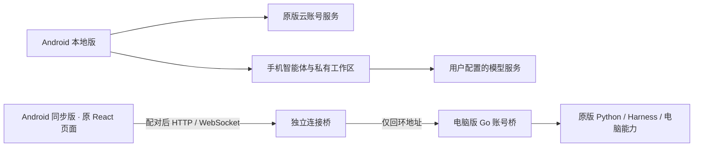

# Xfriend Android 0.2 移植方案

基准：D:/octop 当前工作树（Singu Xfriend 1.4.7）；不使用旧目录 Octop 的历史界面。

## 两个交付版本

| 项目 | 本地版 | 电脑版同步版 |
| --- | --- | --- |
| 应用 ID | com.singu.xfriend.mobile | com.singu.xfriend.mobile.companion |
| 执行位置 | Android 本机 Kotlin 智能体循环，模型调用远端供应商 | 电脑当前账号的原有 Python / Harness / DSH 能力 |
| 界面 | 原版品牌、主题、导航语义与账号表单移植到 Compose | WebView 加载电脑实时提供的原版 React 页面，包含原图标与主题 |
| 账号 | 原版云端登录、注册、记住账号、保持登录；签名授权校验 | 在电脑登录原账号，手机用随机配对码取得当前账号访问权 |
| 数据 | 按云 user_id / space_id 隔离保存 | 电脑为唯一数据源；读写 API 和 WebSocket 实时转发 |
| 专家/团队/技能/知识 | 保留现有 Android 实现及本机数据 | 完整使用电脑已有功能和资料 |
| 控制电脑 | 不默认获得电脑权限 | 复用原页面的远程桌面、终端、浏览器能力，需电脑已启用对应功能 |

“同步”指同一份电脑数据实时访问，不代表把手机离线库合并进电脑。本地版的模型、团队调度、知识检索仍是 Android 实现，不把它宣传成整个 Python 运行时的等价移植。

## 视觉复刻依据

- 图标直接复制 desktop/src/assets/xfriend-icon.png，保留蓝色星星角色，不重新绘制。
- 主题依据 dashboard/src/styles/theme-vars.css 与 themePalettes.ts：主色 #E85D75，页面 #F5F6F8，卡片白色，正文 #111827，边框 #E5E7EB。
- 登录布局依据 pages/Login/CloudLogin.tsx：52px 品牌图、Singu Xfriend 标题、居中白色卡片，移动端 24dp 边距、窄屏滚动和键盘避让。
- 注册保留昵称、邮箱、手机号、密码、确认密码；不添加不存在的短信验证，不额外要求 12 位密码。
- 原版导航图标来自 lucide-react 0.562.0，移植保留路径和 ISC 许可；同步版自然使用电脑原资源。
- 本地版采用抽屉侧栏，保留对话、专家、团队、技能包、知识库、连接平台、设置入口。并非仅把原桌面宽页面缩小。

## 登录与数据边界

Android 调用同一发布配置中的 /api/v2/auth/login、register、refresh、logout。设备标识对 Android 按应用签名限定的 ANDROID_ID 做 SHA-256，满足管理端的 64 位小写十六进制要求；缺失时使用持久化随机值的摘要。校验原版 Ed25519 公钥、product、user_id、space_id、device_id、时间和 72 小时上限。密码只在提交时使用，不持久化。刷新令牌由 Android Keystore AES-GCM 加密，写入 noBackupFilesDir。首次登录不会自动认领 0.1 无账号数据，避免把旧数据给错误用户；旧目录保留。

## 电脑连接桥

原 Go 桌面桥仅监听 127.0.0.1，并校验 Host / Origin。维持这些约束；在独立目录提供 opt-in Python aiohttp 桥，不修改原版桌面工作树。

连接桥先校验随机配对码，再发 HttpOnly / SameSite=Strict 会话；TLS 模式同时 Secure。每次请求绑定电脑当前 user_id + space_id，切换账号后要求重新配对。禁止手机通过连接桥切换/退出电脑云账号。HTTP、上传、流式响应及 WebSocket 文本/二进制透传；只转发到启动参数指定的回环地址，不是任意 URL 代理。

首次配对兼容 Android WebView 的 `Origin: null`，但必须验证完整随机配对码，不使用已有 Cookie 代替配对。后续写操作和 WebSocket 必须严格同源；已打开的 WebSocket 每 2 秒复核连接和电脑账号状态。对应空来源、跨域写、账号退出及长连接撤销均有测试。

默认 USB 模式：连接桥只监听回环，adb reverse 转发。局域网/远程模式：必须提供受信任证书，手机拒绝证书错误与 HTTPS 混合内容。配对码意味着当前电脑账号的操作权限，只交给自己的设备；停止桥进程撤销全部会话。不自动修改防火墙或开放公网端口。

## 验收

1. 原版图标哈希一致；登录/注册/抽屉及同步入口截图检查。
2. 单元测试覆盖签名篡改、设备/账号不匹配、过期、回拨、地址校验和既有本地工具循环。
3. 桥测试覆盖未配对拒绝、限速、跨域写拒绝、账号切换撤销、原 HTTP 数据及 WebSocket 文本/二进制往返。
4. 两个 APK 均执行 Gradle 单元测试、lint、assemble，并在模拟器安装启动。
5. 真账号登录、真实远程桌面控制和生产 LLM 调用需实际设备/账号联调；测试记录必须区分模拟服务和真实外部服务。
