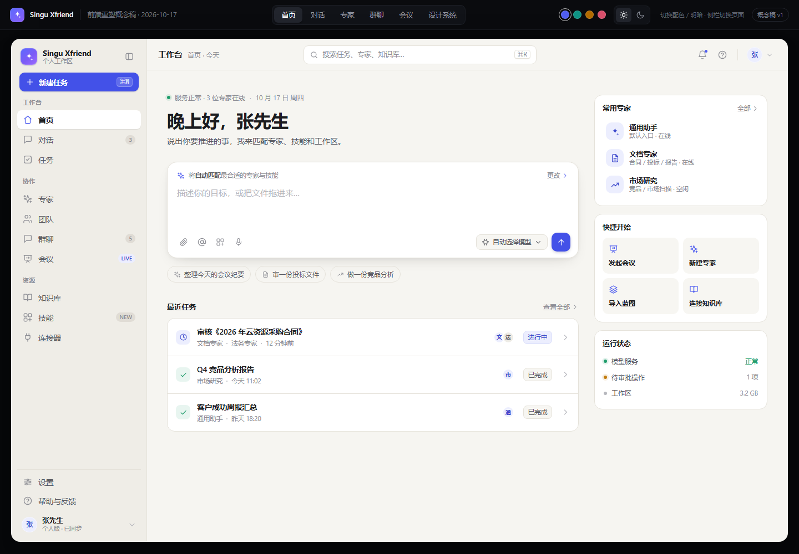
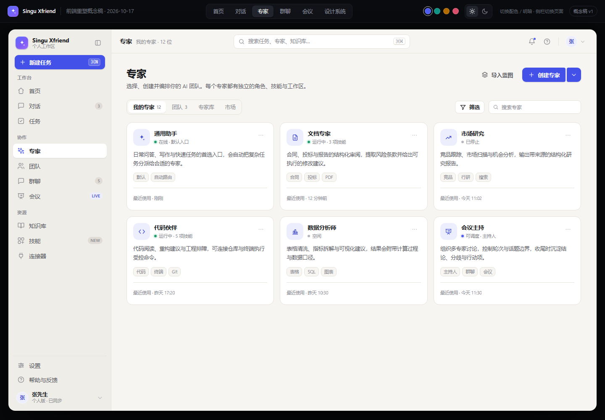
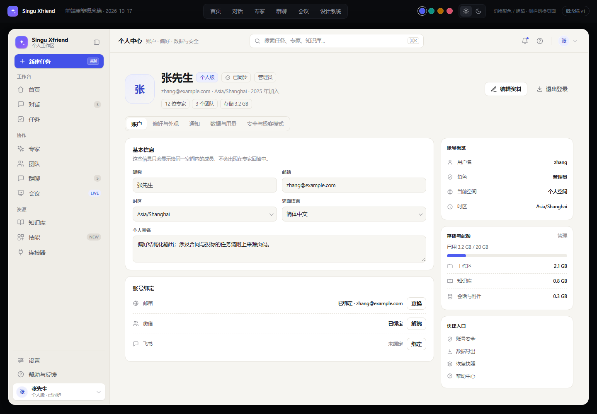
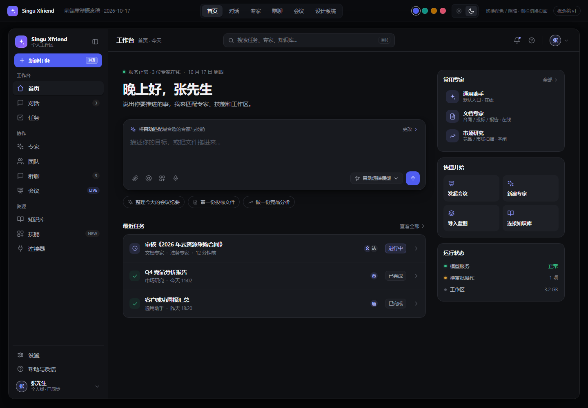

# Singu Xfriend 前端重塑概念稿 v1 → Android（Jetpack Compose）设计规范

> 提取对象：`D:\octop\docs\design\redesign-concept.html`（4390 行 / 315 KB，自包含 HTML，中文 UTF-8）
> 参考稿：`D:\octop\docs\design\group-chat-c-v1\index.html`（概念稿 + 群聊/执行编排扩展，4719 行）
> 现有 Android 基线：`D:\xfriend-suite`（XFriend / XSalers 两个 flavor，Compose + Haze 0.7.3 + Material3）
> 产出日期：2026-10-17 · 状态：**待评审，未实施**（本文档只描述目标，不修改任何源码）

## 0. 文档信息、证据与边界

### 0.1 提取方法（可复核）

| 步骤 | 方法 | 结果 |
|---|---|---|
| 令牌 | 读取 `<style>` 第 14–78 行 `:root` / `html[data-theme]` / `html[data-accent]` | light/dark 中性色、4 套 accent、radius/字体/栏宽全部取原文值 |
| 组件 | 读取 CSS 第 264–1309 行逐选择器 | 尺寸、圆角、hover/active、阴影、响应式断点 |
| 页面 | lxml 解析 12 个 `<section class="screen">`，导出标题/按钮/标签/列表行结构 | 页面分区、栏目标题、示例数据、交互 |
| 图标 | 解析 `<symbol>` 定义 + 设计系统页 icon-grid | 60 个 symbol，24 视窗、1.75 stroke、round cap/join |
| 视觉复核 | headless Edge（CDP）按屏截图，明暗 × accent 采样 | `docs/design/screens/concept-*.png`，见附录 A |
| 基线核对 | 读取 `ProductBrand.kt`、`ProductAppearance.kt`、`FamilyComponents.kt`、`AssistantScreen.kt`、`SalesScreen.kt` 等 | 现有 IA、主题、底栏、页边距与 Haze 用法 |
| 现状截图 | 查看 `docs/xfamily-0.10/01-xfriend-conversation.png`、`03-xsalers-revised.png` | 确认 0.10 现状：XFriend 蓝/4 tab、XSalers 紫/5 tab、18dp 卡片、冷灰底、Haze 底栏 |

> **基线版本说明：** `docs/MOBILE-DESIGN.md` 是 0.2 的移植方案（旧主色 `#E85D75`、旧底色 `#F5F6F8`、抽屉侧栏），与 0.10 现状不一致，**不作为本次视觉基线**。本次以 `docs/XFAMILY-0.10-交付说明.txt`、`docs/xfamily-0.10/*.png` 与当前 Kotlin/Compose 代码为准。

> 概念稿是**桌面/网页端**（viewport 1280、侧栏 244px、顶栏 56px、无移动底栏、无 `bottom-nav` / safe-area）。因此第 4 章中**底部导航、触控高度、系统字号缩放、无障碍**属于「基于概念稿令牌的 Android 派生规范」，文中标注【派生】；其余均为原文值。

### 0.2 概念稿实际包含的 12 个 screen

`home`（工作台首页）、`chat`（对话）、`experts`（专家/团队/专家库/市场）、`expert-detail`（专家主页）、`team-detail`（团队主页）、`create-simple`（简易创建）、`create-pro`（专业创建）、`group`（群聊，含执行计划/审批/引擎插件）、`room`（会议）、`artifact`（决策档案/资料库暗色长页）、`profile`（个人中心）、`system`（设计系统）。

概念稿的「群聊 / 会议 / 决策档案」只在 `group-chat-c-v1` 与主稿的 group/room/artifact 中存在；**现有两个 App 都没有群聊/会议业务**（XFriend 的团队是顺序协作，XSalers 无群聊/会议入口）。因此这三类页面不作为 Android 功能页实现，只提取其视觉组件用于「任务执行详情 / 审批 / 结果档案」等既有真实功能（详见 6.5）。

### 0.3 术语

- **概念稿 px**：桌面 CSS 像素，1280 视口基准；1 px 约等于 1 dp 的视觉密度，但 Android 手机需要把正文和控件放大（见 2.2 / 2.5）。
- **令牌**：颜色/圆角/间距/字体的最小语义单位；Android 侧统一收敛到 `XfColors` / `XfAccentColors` / `XfSpacing` / `XfRadius` / `XfElevation` / `XfType`。
- **品牌色**：XFriend 蓝 `#5267E8`、XSalers 紫 `#7055DE`（来自 `ProductBrand.kt:19`），与概念稿 4 套 accent 并列存在，默认 accent = 品牌色。
- **概念 accent**：indigo / teal / amber / rose 四套可切换主色（概念稿 `data-accent`）。

---

## 1. 设计令牌总表

### 1.1 令牌来源（CSS 行号）

| 令牌组 | 概念稿位置 |
|---|---|
| 字体族 / 圆角 / 侧栏宽 / 顶栏高 / 缓动 | `:root`，第 14–26 行 |
| light 中性色 + 语义色 + 阴影 + overlay | `html[data-theme="light"]`，第 27–48 行 |
| dark 中性色 + 语义色 + 阴影 + overlay | `html[data-theme="dark"]`，第 49–70 行 |
| 4 套 accent（light） | 第 71–74 行 |
| 4 套 accent（dark） | 第 75–78 行 |
| 图标基线 | `.i`，第 92–95 行 |
| 响应式断点 | 第 1237–1309 行 |

### 1.2 中性色与语义色（light / dark 全量）

| 令牌 | Light | Dark | Android Compose 命名 | 用途 |
|---|---|---|---|---|
| `--canvas` | `#F6F5F1` | `#0E0F12` | `XfColors.Canvas` | 页面底色、顶栏底、聊天/会议主区底 |
| `--canvas-2` | `#EFEDE7` | `#131418` | `XfColors.Canvas2` | 次级页面底色、深浅分区 |
| `--sidebar` | `#EFEDE7` | `#121317` | `XfColors.Sidebar` | 桌面侧栏/历史栏底（Android 无侧栏，保留令牌用于抽屉/底栏渐层） |
| `--surface` | `#FFFFFF` | `#181A1F` | `XfColors.Surface` | 卡片、面板、弹窗、输入容器 |
| `--surface-2` | `#F7F6F2` | `#1E2026` | `XfColors.Surface2` | 卡片内次级块、快速入口、chip 底、hover 底 |
| `--surface-3` | `#EEECE6` | `#24262D` | `XfColors.Surface3` | 进度槽、头像底色、禁用块、keyboard 键帽 |
| `--line` | `#E5E2DA` | `#282A31` | `XfColors.Line` | 1px 边框、分隔线、卡片描边 |
| `--line-strong` | `#D6D2C7` | `#373A43` | `XfColors.LineStrong` | hover 描边、虚线卡描边、开关槽描边 |
| `--ink` | `#1B1C1F` | `#F1F2F4` | `XfColors.Ink` | 主文字、标题 |
| `--ink-2` | `#57585F` | `#AAAEB8` | `XfColors.Ink2` | 正文/次要文字、幽灵按钮 |
| `--ink-3` | `#8C8D94` | `#7B7F89` | `XfColors.Ink3` | 元信息、说明、placeholder、图标默认 |
| `--ink-4` | `#B6B7BD` | `#565A64` | `XfColors.Ink4` | 装饰性箭头/分隔点（**不可作正文**） |
| `--green` | `#1F9D6B` | `#37C08A` | `XfColors.Green` | 成功/在线/已通过 |
| `--amber` | `#C27C0E` | `#E0A33A` | `XfColors.Amber` | 等待/审批/风险提示 |
| `--red` | `#D5443B` | `#F06B62` | `XfColors.Red` | 危险/失败/删除 |
| `--blue` | `#3B82F6` | `#6FA8FF` | `XfColors.Blue` | 信息/链接（概念稿定义但极少使用） |

### 1.3 Accent 主色色板（概念稿原值）

**Light：**

| 色板 | 中文名 | `--accent` | `--accent-solid` | `--accent-ink` | `--accent-soft` | `--accent-line` |
|---|---|---|---|---|---|---|
| indigo | 靛蓝（默认） | `#4F5DF0` | `#4351E8` | `#3B47CC` | `#ECEEFE` | `#D9DEFB` |
| teal | 青绿 | `#0E9384` | `#0B7F73` | `#0A7568` | `#E4F6F2` | `#C6EDE5` |
| amber | 琥珀 | `#B26B00` | `#996000` | `#8F5600` | `#FCF1DF` | `#F4DFB9` |
| rose | 玫瑰 | `#D94F6B` | `#C74059` | `#B33B54` | `#FDECEF` | `#F8D3DB` |

**Dark（`accent`/`ink` 提亮，`soft`/`line` 改为 alpha）：**

| 色板 | `--accent` | `--accent-solid` | `--accent-ink` | `--accent-soft` | `--accent-line` | soft 合成到 `#181A1F` * | line 合成到 `#181A1F` * |
|---|---|---|---|---|---|---|---|
| indigo | `#8B95FF` | `#4F5DF0` | `#A6AEFF` | `rgba(139,149,255,.13)` | `rgba(139,149,255,.28)` | `#272A3C` | `#383C5E` |
| teal | `#4FD1C5` | `#0B7F73` | `#7EE3D9` | `rgba(79,209,197,.12)` | `rgba(79,209,197,.26)` | `#1F3033` | `#264A4A` |
| amber | `#E8B05A` | `#8F5600` | `#F2C778` | `rgba(232,176,90,.12)` | `rgba(232,176,90,.26)` | `#312C26` | `#4E412E` |
| rose | `#FF8FA3` | `#C2435C` | `#FFAEBE` | `rgba(255,143,163,.12)` | `rgba(255,143,163,.28)` | `#34282F` | `#593B44` |

\* 概念稿 dark 的 soft/line 是半透明色。Compose 中若作为 `MaterialTheme.colorScheme` 的容器角色（需不透明），使用上表合成值；若只作为背景叠加，可直接用 alpha Color（推荐 `AccentSoft.copy(alpha=.13f)` 保持可组合性）。

### 1.4 品牌 accent 扩展（派生，非概念稿原值）

概念稿没有 XFriend 蓝 / XSalers 紫，但两个 App 的品牌识别必须保留。按概念稿「accent / solid / ink / soft / line」结构派生（数值经对比度校验，见 7.4）：

**XFriend（品牌蓝 #5267E8）**

| 令牌 | Light | Dark | 说明 |
|---|---|---|---|
| accent | `#5A6BEA` | `#A9B6FF` | 图标/进度/焦点 |
| accent-solid | `#5267E8` | `#5267E8` | 白字 4.70:1（AA 正常文字通过） |
| accent-ink | `#3F50C4` | `#C3CCFF` | 用于 soft 底上的文字/图标 |
| accent-soft | `#EAEEFE` | `rgba(169,182,255,.13)`（合成 `#2B2E3C`） | 选中底、chip 底 |
| accent-line | `#D6DEFB` | `rgba(169,182,255,.28)`（合成 `#41465E`） | 边框 |

**XSalers（品牌紫 #7055DE）**

| 令牌 | Light | Dark | 说明 |
|---|---|---|---|
| accent | `#7A62E6` | `#BCA9FF` | 图标/进度/焦点 |
| accent-solid | `#7055DE` | `#7055DE` | 白字 5.19:1 |
| accent-ink | `#5B43BF` | `#D3C7FF` | soft 底文字 |
| accent-soft | `#F0ECFF` | `rgba(188,169,255,.14)`（合成 `#2F2E3E`） | 与现有 `primaryContainer` 一致 |
| accent-line | `#DED6FB` | `rgba(188,169,255,.28)`（合成 `#46425E`） | 边框 |

**默认策略：** 两 App 默认 accent = `brand`（即上表），**不改变现有品牌色**；概念稿 4 套 accent 作为「外观设置」里的可选预设（P1）。切换 accent 只替换 accent 五元组，不动中性色与品牌 Logo。

### 1.5 语义容器与可访问文字色（派生）

概念稿只给语义基色，未给容器。按「语义色 10–16% 叠加 surface」派生成不透明容器色，并给出可在小字号使用的深/浅文字色（7.4 实测 ≥4.5:1）：

| 语义 | 基色 light / dark | 容器 light（叠加 `#FFFFFF`） | 容器 dark（叠加 `#181A1F`） | 文字 light（≥4.5） | 文字 dark |
|---|---|---|---|---|---|
| 成功 success | `#1F9D6B` / `#37C08A` | `#E9F5F0`（.10） | `#1C312E`（.14） | `#17754F`（5.21:1 on canvas） | `#37C08A`（7.52:1 on surface） |
| 警告 warning | `#C27C0E` / `#E0A33A` | `#F7EEE0`（.13） | `#342D23`（.14） | `#8A5600`（5.64:1） | `#E0A33A`（7.85:1） |
| 危险 danger | `#D5443B` / `#F06B62` | `#FBECEB`（.10） | `#3B272A`（.16） | `#C0342C`（5.11:1） | `#F06B62`（5.79:1） |
| 信息 info | `#3B82F6` / `#6FA8FF` | `#EBF2FE`（.10） | `#242E3E`（.14） | `#2563EB`（4.74:1） | `#6FA8FF`（7.96:1） |
| 强调 accent | 见 1.3/1.4 | `AccentSoft` | `AccentSoft` | `AccentInk`（light 5.0–6.2:1 / dark ≥6:1，详见 7.4） | `AccentInk` |

Compose 命名：`SuccessContainer`、`WarningContainer`、`DangerContainer`、`InfoContainer`、`SuccessText`、`WarningText`、`DangerText`、`InfoText`。

### 1.6 阴影 / overlay / 透明度

| 令牌 | 原值（light） | Dark | Android 映射 |
|---|---|---|---|
| `--shadow-1` | `0 1px 2px rgba(24,22,16,.05), 0 1px 1px rgba(24,22,16,.03)` | `0 1px 2px rgba(0,0,0,.4)` | `XfElevation.Card = 1.dp`；列表悬停层 0–1dp |
| `--shadow-2` | `0 10px 30px -16px rgba(24,22,16,.24), 0 2px 6px rgba(24,22,16,.04)` | `0 12px 32px -16px rgba(0,0,0,.7), 0 2px 6px rgba(0,0,0,.35)` | `XfElevation.Raised = 2.dp`（手机端不照搬桌面大扩散阴影，见 2.6） |
| `--shadow-3` | `0 28px 60px -28px rgba(24,22,16,.36)` | `0 32px 72px -32px rgba(0,0,0,.9)` | `XfElevation.Modal = 12.dp`（弹窗/底部抽屉） |
| `--overlay` | `rgba(20,18,12,.28)` | `rgba(0,0,0,.5)` | `XfColors.Overlay` = `Color(0x4714120C)` / `Color(0x80000000)` |
| 透明度习惯 | hover 背景 `rgba(120,112,96,.10~.13)`；disabled 由组件派生（概念稿未定义） | 同左 | hover 用 `OnSurface.copy(alpha=.08f)`；disabled = 内容 38%、容器 12%（M3 派生） |

### 1.7 Compose 结构与 Material3 角色映射

```kotlin
// 建议新增：XfTokens.kt（纯数据，无依赖）
@Immutable data class XfAccentColors(
    val accent: Color, val accentSolid: Color, val accentInk: Color,
    val accentSoft: Color, val accentLine: Color,
)
@Immutable data class XfColors(
    val canvas: Color, val canvas2: Color, val sidebar: Color,
    val surface: Color, val surface2: Color, val surface3: Color,
    val line: Color, val lineStrong: Color,
    val ink: Color, val ink2: Color, val ink3: Color, val ink4: Color,
    val green: Color, val amber: Color, val red: Color, val blue: Color,
    val successContainer: Color, val warningContainer: Color,
    val dangerContainer: Color, val infoContainer: Color,
    val successText: Color, val warningText: Color,
    val dangerText: Color, val infoText: Color,
    val overlay: Color,
)
val LocalXfColors = staticCompositionLocalOf<XfColors> { error("XfTheme missing") }
val LocalXfAccent = staticCompositionLocalOf<XfAccentColors> { error("XfTheme missing") }
```

| Material3 角色 | 取值（light / dark） | 备注 |
|---|---|---|
| `primary` | `AccentSolid` | 填充按钮、选中态 |
| `onPrimary` | `Color.White` | 概念稿 `#fff` |
| `primaryContainer` | `AccentSoft`（dark 用合成不透明值） | 选中 chip / 导航指示器 |
| `onPrimaryContainer` | `AccentInk` | |
| `secondary` / `onSecondary` | `Ink2` / `Canvas` | 概念稿不设第二主色 |
| `background` | `Canvas` | |
| `onBackground` / `onSurface` | `Ink` | |
| `surface` | `Surface` | |
| `surfaceVariant` | `Surface2` | |
| `surfaceContainer`（M3 1.2+） | `Surface2`；`surfaceContainerHigh=Surface3` | 若 BOM 2024.06 无该角色则用 `surfaceVariant` |
| `onSurfaceVariant` | `Ink2` | **不要用 `Ink3` 承担正文** |
| `outline` | `LineStrong` | |
| `outlineVariant` | `Line` | |
| `error` / `errorContainer` | `DangerText` / `DangerContainer` | 概念稿 `--red` 小字对比不足，用 `DangerText` |
| `inverseSurface` / `inverseOnSurface` | `Ink` / `Canvas` | Toast 用（概念稿 `.toast`） |
| `scrim` | `Overlay` | 弹窗遮罩 |

`XfTheme` 建议签名（壳层，不改业务）：

```kotlin
@Composable fun XfTheme(
    themeMode: ThemeMode = ThemeMode.SYSTEM,     // SYSTEM / LIGHT / DARK
    accent: AccentChoice = AccentChoice.BRAND,   // BRAND / INDIGO / TEAL / AMBER / ROSE
    content: @Composable () -> Unit,
) { /* isSystemInDarkTheme() + ProductBrand.isSales → XfColors/XfAccentColors → MaterialTheme */ }
```

---

## 2. 排版与尺寸

### 2.1 字体族回退

概念稿原文（`:root` 第 15–17 行）：

```css
--font-sans: -apple-system, BlinkMacSystemFont, "Segoe UI", "PingFang SC",
             "Hiragino Sans GB", "Microsoft YaHei UI", "Noto Sans SC", sans-serif;
--font-mono: ui-monospace, "SF Mono", "Cascadia Code", Consolas, monospace;
```

Android 映射：

| 用途 | 建议 |
|---|---|
| 中文/拉丁正文 | **系统默认字体**（`FontFamily.Default` = Roboto + 系统 CJK Noto Sans CJK/Sans-serif）。不打包字体，避免 APK 体积与启动开销。 |
| 等宽（数字、token、计时、命令） | `FontFamily.Monospace`；数字列加 `fontFeatureSettings = "tnum"`（对应概念稿 `.tnum`） |
| 字重 | 概念稿 CSS 使用 450/500/550/600/650/700；Android 系统字体通常只有 400/500/700。统一映射：`450→Normal(400)`、`550/600/650→SemiBold(600)`、`700→Bold`。设计系统页声称「只保留 400/500/600」但 CSS 实际使用 650，以组件最终视觉（SemiBold）为准。 |
| 字体缩放 | 全部用 `sp`，禁止 `TextUnit.Unspecified`/固定像素；`lineHeight` 用 sp 并在大字号下允许系统放大（见 7.3）。 |

### 2.2 字号阶梯（概念稿 → Android）

概念稿原文值（含设计系统页「字体层级」）：

| 层级 | 概念稿 | Android Token | Compose | 字重 | 行高 | 字距 |
|---|---|---|---|---|---|---|
| Display / 问候标题 | 30–32 / 700（home h1 32/650） | `XfType.Display` | 28.sp | Bold(700) | 34.sp | -0.6.sp |
| Page Title / 页面标题 | 24–26 / 650（`.page-title` 24、专家主页 26） | `XfType.PageTitle` | 24.sp | Bold | 30.sp | -0.4.sp |
| Section Title / 区块标题 | 13 / 650（设计系统 Title 22/650 为桌面特例） | `XfType.SectionTitle` | 17.sp | SemiBold | 24.sp | 0 |
| Card Title / 卡片标题 | 13.5 / 650 | `XfType.CardTitle` | 16.sp | SemiBold | 22.sp | 0 |
| List Title / 列表主文 | 13.5 / 550 | `XfType.ListTitle` | 16.sp | Medium(500) | 22.sp | 0 |
| Body / 正文 | 14 / 400（`.msg-text` 14/1.72） | `XfType.Body` | 15.sp | Normal | 22.sp（聊天 24.sp） | 0 |
| Body Small / 辅助正文 | 12.5–13 / 400 | `XfType.BodySmall` | 13.sp | Normal | 19.sp | 0 |
| Label / 控件标签 | 11.5–12 / 600 | `XfType.Label` | 12.sp | SemiBold | 16.sp | 0 |
| Caption / 元信息 | 10–11.5 / 400 | `XfType.Caption` | 11.sp | Normal | 16.sp | 0 |
| Overline / 全大写小标 | 10–10.5 / 650，letter-spacing .06–.08em | `XfType.Overline` | 10.sp | SemiBold | 14.sp | 0.6.sp |
| Mono | 13 / 400 | `XfType.Mono` | 12.sp | Normal | 18.sp | 0 |
| Button | 13 / 550 | `XfType.Button` | 14.sp | SemiBold | 20.sp | 0 |
| Nav Label（底栏）【派生】 | — | `XfType.NavLabel` | 11.sp | Medium | 14.sp | 0 |

> 说明：概念稿是 1280 宽桌面，直接 1:1 搬到手机字太小（正文 14px→14sp 可行，但辅助 10.5px 在 Android 上低于可读下限）。上表把正文 +1sp、辅助 +0.5~1sp、最小 11sp；标题按手机阅读惯例收敛到 Display 28 / PageTitle 24，区块标题与卡片标题相对放大，保持层级差。另补一行顶栏标题映射：概念稿 14.5/650 → Android `TopAppBar` 18–20sp / W600（栏高 56dp）。

**Material3 `Typography` 角色映射（替换 `ProductBrand.kt` 现有 `typography.copy`）：**

| M3 角色 | 建议值 | 对应 XfType | 用途 |
|---|---|---|---|
| `displaySmall` | 28sp / 34sp / W700 | Display | 首页问候 |
| `headlineMedium` | 24sp / 30sp / W700 | PageTitle | 页面标题 |
| `titleMedium` | 17sp / 24sp / W600 | SectionTitle | 区块标题 |
| `titleSmall` | 16sp / 22sp / W600 | CardTitle | 卡片标题 |
| `bodyLarge` | 15sp / 22sp / W400 | Body | 正文 |
| `bodyMedium` | 13sp / 19sp / W400 | BodySmall | 辅助正文 |
| `labelLarge` | 14sp / 20sp / W600 | Button | 按钮 |
| `labelMedium` | 12sp / 16sp / W600 | Label | 控件标签 |
| `labelSmall` | 11sp / 16sp / W400 | Caption | 元信息 |
| 自定义 `mono` | 12sp / 18sp / W400 / Monospace | Mono | 数字/命令/计时 |

### 2.3 圆角

| 令牌 | 概念稿 | Android | 用途 |
|---|---|---|---|
| `--radius-xs` | 6px | `XfRadius.Xs = 6.dp` | 小标签、role-tag、键帽 |
| `--radius-sm` | 8px | `XfRadius.Sm = 8.dp` | 按钮 sm、图标按钮、输入、菜单项 |
| `--radius-md` | 10px | `XfRadius.Md = 10.dp` | 输入框组合、结果卡、quick-item |
| `--radius-lg` | 14px | `XfRadius.Lg = 14.dp` | **标准卡片/面板/输入大容器** |
| `--radius-xl` | 18px | `XfRadius.Xl = 18.dp` | Hero 输入区、大卡片、底部抽屉顶角 |
| 弹窗 | 16px | `XfRadius.Dialog = 16.dp` | AlertDialog / Modal |
| 胶囊 | 999px | `XfRadius.Pill = 50%` | 建议 chip、状态点、分段外层不需要 |
| 现有基线 | 18dp 卡片 / 14dp 控件 | 迁移建议：**新组件用 14dp 卡片 + 10dp 控件 + 8dp 按钮**；现有 18dp 页面逐步替换（见 7.7） | 概念稿与现有基线差异需一次性收敛，避免混用 |

Material3 `Shapes` 映射：`extraSmall=6.dp`、`small=10.dp`、`medium=14.dp`、`large=18.dp`、`extraLarge=24.dp`（底部抽屉）。

### 2.4 间距、页边距、栏宽、控件高度

**布局尺寸（概念稿原值）：**

| 项目 | 概念稿 | Android 建议 | 备注 |
|---|---|---|---|
| 页面最大宽 | 1240px（home/page/system） | 手机 `fillMaxWidth`；平板 ≤ 840dp 内容宽 | 桌面居中留白不复刻 |
| 页面内边距 | 32–36px（home 34/36；page 32/36；移动断点 22/18） | 手机 20dp；平板 24–32dp；与现有 `ProductAppearance.pagePadding = 20.dp` 对齐 | P0 基线 |
| 侧栏宽 | 244px（<1060 236，<920 折叠 72） | **不做侧栏**；用 ModalNavigationDrawer/底部抽屉承载 | 保留导航层级，不照搬桌面侧栏 |
| 顶栏高 | 56px（`--topbar-h`；chat head 56、room head 58、create top 56） | 56dp（M3 SmallTopAppBar）；带副标题时 64dp | |
| 历史栏 / 上下文栏 / 成员栏 | 264 / 280 / 280px | 全屏列表或 ModalBottomSheet；不常驻 | |
| 聊天阅读宽 | 760px | 手机全宽；平板 `widthIn(max = 720.dp)` 居中 | |
| 专家网格 | 3 列，gap 14；<1400 两列，<780 一列 | 手机 1 列；≥600dp 2 列；≥840dp 3 列 | `LazyVerticalGrid(Adaptive)` |
| 卡片间距 | 14px（区块间 34px） | 列表 12dp；区块 24dp | 4dp 网格 |
| 卡片内边距 | 14–16px（hero 14/14/11） | 16dp | |
| Hero 输入区 | padding 14/14/11，radius 18，shadow-2 | 16dp，radius 18，tonal surface + border | |
| 分段控件 | 外层 padding 3，内钮高 28 | 外层 3dp，内钮 36dp（触控 48） | |
| 输入控件 | 36px | 44dp 视觉 + 48dp 触控 | |
| 按钮 | 34px；sm 30；xs 24–26 | 主按钮 44–48dp；sm 40dp；xs 32dp 视觉 + 48dp 触控 | |
| 列表行 | task 13/15 上下 padding（≈52px）；expert 8/6（≈48）；member 6/4（≈36）；文件行 11/2（≈40） | 主行 ≥56dp；双行 ≥64dp；紧凑行 48dp；触控 ≥48dp | |
| 对话框 | 580px 宽、max-height 82% | 手机宽度减 24dp 边距，max 560dp；底部抽屉代替 | |
| 弹出菜单 | 230px 宽，radius 12，shadow-3 | DropdownMenu（min 200dp） | |
| Toast | bottom 26px | Snackbar 风格，距底栏 16dp + insets | |
| 底栏【派生】 | 概念稿无 | M3 `NavigationBar` 80dp + 系统 insets；4/5 项；保留 Haze | |

**间距阶梯（dp）：** `0, 2, 4, 6, 8, 12, 16, 20, 24, 32, 40, 48`。概念稿的 3/5/7/9/10/11/13/14/15 收敛到最近 4dp 网格；列表内部（图标与文字）用 8/10/12dp 例外。常用组合：

| 场景 | 值 |
|---|---|
| 页面左右边距 | 20dp |
| 区块上下间距 | 24dp |
| 卡片间距 | 12dp |
| 卡片内边距 | 16dp |
| 卡片标题→正文 | 8dp |
| 列表行左右 | 16dp；上下 12–14dp |
| 图标↔文字 | 8–10dp |
| 按钮内左右 | 16dp |
| 弹窗内边距 | 20dp |
| 底栏内容与系统手势区 | `WindowInsets.navigationBars` |

### 2.5 阴影 → Compose elevation 建议

概念稿是 CSS 大扩散柔和阴影，直接映射到 Android `elevation` 会显得脏、且在深色模式不可见。建议：

| 语义 | 概念稿 | Compose 建议（light） | Dark |
|---|---|---|---|
| 卡片静止 | shadow-1 | `elevation = 1.dp` + `border(1.dp, Line)`；或纯 border + surface | 0dp + border（用 `Line` 区分层级） |
| 卡片按下/浮起 | shadow-2 | 2dp（仅少数可交互大卡） | 0dp + border + Surface2 |
| 弹出菜单 / 分段浮层 | shadow-3 | 8dp（DropdownMenu 自带 3dp，可加 border） | 8dp + border |
| 弹窗 / ModalBottomSheet | shadow-3 | 12–16dp + `Overlay` scrim | 12dp + border |
| 底栏 | 无（Haze 毛玻璃） | 保留 Haze，不额外 elevation | 同左 |

实现注意：
- `Modifier.shadow` 在 API 28 以下使用黑色 ambient/spot；深色模式改用 1dp `Line` 描边 + `Surface2` 色差，不依赖阴影。
- 列表卡片不要逐项 shadow（性能与视觉噪音）；用 `border + surface` 即可。
- 圆角与阴影必须同 shape（`RoundedCornerShape(XfRadius.Lg)`），否则 Compose 阴影溢出。

### 2.6 触控目标与系统字号【派生】

- 所有可点击元素：**视觉尺寸可 32–44dp，但命中区必须 ≥48×48dp**（`Modifier.minimumInteractiveComponentSize()` 或外层 `sizeIn(minWidth=48.dp, minHeight=48.dp)`）。现有 `ProductAppearance.minimumTouchTarget = 48.dp` 继续作为硬约束。
- 系统字号：使用 `sp`，不锁 `fontScale`；布局避免固定高度包裹多行文字（改用 `heightIn(min=...)`）。
- 系统显示大小（density）变化时，图标用 dp、文字用 sp；不使用 `LocalDensity` 手工换算字号。
- 大字号（fontScale 1.3 / 1.5 / 2.0）验收：底栏标签不截断、按钮文字不溢出、列表行自动增高、顶部栏标题最多 2 行。

---

## 3. 图标语言

### 3.1 绘制规范（概念稿原值）

| 项 | 规范 |
|---|---|
| 视窗 | `viewBox="0 0 24 24"`，24 网格 |
| 描边 | `stroke-width: 1.75`，`fill: none` |
| 线帽 / 连接 | `stroke-linecap: round`，`stroke-linejoin: round` |
| 颜色 | `stroke: currentColor`，继承文字色；语义色只用于状态图标 |
| 尺寸档位 | 默认 18px（`.i`）、16px（`.i.sm`）、14px（`.i.xs`）、20px（`.i.lg`）；设计系统页规定「16 / 18 / 20」三档，14 仅内联小图标 |
| 品牌星标 | `i-brand` 为**填充**路径（`fill: currentColor`，`stroke: none`），不是线性图标 |
| 禁止 | emoji、线性与填充混排、同屏 6 种以上图标底色、旧红色字标/章鱼吉祥物/位图 wordmark |

设计系统页的组件规则（`redesign-concept.html:3683-3688`）：
- 统一容器：专家头像固定 40px 圆角方块，底色主色 8% 透明，图标单色。
- 统一尺寸：导航 18px、行内 16px、强调 20px，不按页面随意改。

### 3.2 图标清单（60 个 symbol 全量）

> 「Android 建议」优先使用项目**已存在**的 `material-icons-extended`（`app/build.gradle.kts:51`）中形状接近的 Outlined 图标；「手绘」= 用 `res/drawable/*.xml`（24 viewport、1.75 stroke、round cap）补足，不引入新图标库。

| # | symbol id | 含义 / 用途 | Android 建议 |
|---|---|---|---|
| 1 | `i-brand` | 品牌几何星标（Logo、AI 头像、加载、选中） | 手绘（保留现状 `xfriend_star` drawable；XSalers 沿用现有图标） |
| 2 | `i-home` | 首页 / 工作台 | `Icons.Outlined.Home` |
| 3 | `i-chat` | 对话（导航、专家行操作） | `Icons.Outlined.ChatBubbleOutline` |
| 4 | `i-tasks` | 任务 | `Icons.Outlined.TaskAlt` |
| 5 | `i-sparkles` | 专家 / 自动匹配 / AI 生成 | `Icons.Outlined.AutoAwesome` |
| 6 | `i-users` | 团队 / 多位成员 | `Icons.Outlined.Groups` |
| 7 | `i-meeting` | 会议房间 | `Icons.Outlined.Videocam`（无会议业务时不用） |
| 8 | `i-book` | 知识库 | `Icons.Outlined.MenuBook` |
| 9 | `i-blocks` | 技能 / 工具块 | `Icons.Outlined.Extension` |
| 10 | `i-plug` | 连接器 / 插件 | `Icons.Outlined.Power` 或 `Cable` |
| 11 | `i-settings` | 设置 / 参数滑杆 | `Icons.Outlined.Tune` |
| 12 | `i-help` | 帮助与反馈 | `Icons.Outlined.HelpOutline` |
| 13 | `i-plus` | 新建 / 添加 | `Icons.Outlined.Add` |
| 14 | `i-search` | 搜索 | `Icons.Outlined.Search` |
| 15 | `i-bell` | 通知 | `Icons.Outlined.NotificationsNone` |
| 16 | `i-sun` | 浅色模式 | `Icons.Outlined.LightMode` |
| 17 | `i-moon` | 深色模式 | `Icons.Outlined.DarkMode` |
| 18 | `i-chev-down` | 展开 / 下拉 | `Icons.Outlined.KeyboardArrowDown` |
| 19 | `i-chev-right` | 进入 / 返回（旋转 180°） | `Icons.Outlined.KeyboardArrowRight` / `AutoMirrored` |
| 20 | `i-more` | 更多（三点） | `Icons.Outlined.MoreHoriz` |
| 21 | `i-panel` | 侧栏收起 | `Icons.Outlined.ViewSidebar`（Android 不用） |
| 22 | `i-clip` | 附件 | `Icons.Outlined.AttachFile` |
| 23 | `i-mic` | 语音输入 | `Icons.Outlined.MicNone` |
| 24 | `i-arrow-up` | 发送 / 上送 | `Icons.Outlined.ArrowUpward` |
| 25 | `i-file` | 文件 | `Icons.Outlined.InsertDriveFile` |
| 26 | `i-check` | 完成 / 勾选 | `Icons.Outlined.Check` |
| 27 | `i-check-circle` | 成功 / 已通过 | `Icons.Outlined.CheckCircleOutline` |
| 28 | `i-clock` | 进行中 / 等待 | `Icons.Outlined.Schedule` |
| 29 | `i-pause` | 暂停 | `Icons.Outlined.Pause` |
| 30 | `i-stop` | 停止 / 结束 | `Icons.Outlined.Stop` |
| 31 | `i-x` | 关闭 / 移除 | `Icons.Outlined.Close` |
| 32 | `i-filter` | 筛选 | `Icons.Outlined.FilterAlt` |
| 33 | `i-grid` | 网格视图 | `Icons.Outlined.GridView` |
| 34 | `i-user-plus` | 邀请成员 | `Icons.Outlined.PersonAddAlt` |
| 35 | `i-calendar` | 日程 / 日期 | `Icons.Outlined.CalendarToday` |
| 36 | `i-cpu` | 模型 / 引擎 | `Icons.Outlined.Memory` |
| 37 | `i-code` | 代码 | `Icons.Outlined.Code` |
| 38 | `i-trending` | 趋势 / 增长 | `Icons.Outlined.TrendingUp` |
| 39 | `i-chart` | 图表 / 复盘 | `Icons.Outlined.BarChart` |
| 40 | `i-shield` | 安全 / 审批 | `Icons.Outlined.Shield` |
| 41 | `i-database` | 数据 / 存储 | `Icons.Outlined.Storage` |
| 42 | `i-globe` | 网络 / 公开检索 | `Icons.Outlined.Public` |
| 43 | `i-edit` | 编辑 | `Icons.Outlined.Edit` |
| 44 | `i-at` | 提及 / 邮箱 | `Icons.Outlined.AlternateEmail` |
| 45 | `i-folder` | 工作区 / 目录 | `Icons.Outlined.FolderOpen` |
| 46 | `i-export` | 导出 / 分享 | `Icons.Outlined.IosShare` 或 `FileDownload` |
| 47 | `i-play` | 播放 / 继续 | `Icons.Outlined.PlayArrow` |
| 48 | `i-palette` | 外观 / 主题色 | `Icons.Outlined.Palette` |
| 49 | `i-inbox` | 收件 / 待处理 | `Icons.Outlined.Inbox` |
| 50 | `i-layers` | 蓝图 / 分层 | `Icons.Outlined.Layers` |
| 51 | `i-command` | 快捷键（⌘K） | `Icons.Outlined.KeyboardCommandKey`（Android 不用） |
| 52 | `i-user` | 用户 / 头像 | `Icons.Outlined.PersonOutline` |
| 53 | `i-monitor` | 电脑 / 桌面 | `Icons.Outlined.DesktopWindows` |
| 54 | `i-laptop` | 笔记本 | `Icons.Outlined.Laptop` |
| 55 | `i-refresh` | 刷新 / 重试 | `Icons.Outlined.Refresh` |
| 56 | `i-fingerprint` | 生物识别 / 安全 | `Icons.Outlined.Fingerprint` |
| 57 | `i-pin` | 置顶 / Pin | `Icons.Outlined.PushPin` |
| 58 | `i-thumb-up` | 赞 / 有用 | `Icons.Outlined.ThumbUp` |
| 59 | `i-thumb-down` | 踩 / 无用 | `Icons.Outlined.ThumbDown` |
| 60 | `i-copy` | 复制 | `Icons.Outlined.ContentCopy` |

另有设计系统页展示的 24 个「核心图标」（`redesign-concept.html:3657-3682`）：home/chat/tasks/sparkles/users/meeting/book/blocks/plug/meeting(重复)/cpu/code/trending/file/folder/shield/database/globe/settings/clip/mic/arrow-up/search/bell/user-plus。Android 只需保证这 24 个在导航/工具条/快捷入口中视觉一致；其余 36 个按需映射。

### 3.3 Android 实现建议（不引入大依赖）

现状：`material-icons-extended` 已在依赖中（体积已付出，不要重复引入其他图标库）。建议：

1. **优先用现有 `Icons.Outlined.*`**，通过 `Icon(imageVector, tint = LocalContentColor.current)` 继承颜色；导航栏 20–24dp、行内 16–18dp、强调 20dp。
2. **只对品牌/识别关键项手绘**（约 8–12 个）：`i-brand`、`i-sparkles`（如 Material `AutoAwesome` 形状差异大）、`i-meeting`、`i-blocks`、`i-plug`、`i-cpu`、`i-command`、`i-panel`。手绘放 `app/src/main/res/drawable/xf_ic_*.xml`：
   ```xml
   <vector xmlns:android="http://schemas.android.com/apk/res/android"
       android:width="24dp" android:height="24dp"
       android:viewportWidth="24" android:viewportHeight="24">
     <path android:pathData="M12 19V5M5.5 11.5l6.5-6.5 6.5 6.5"
           android:strokeColor="#FF000000" android:strokeWidth="1.75"
           android:strokeLineCap="round" android:strokeLineJoin="round"
           android:fillColor="@android:color/transparent"/>
   </vector>
   ```
   用 `Icon(painterResource(R.drawable.xf_ic_arrow_up), ...)` 并 `tint` 染色。**不要**为了 60 个图标新增依赖或打包整套 SVG。
3. **尺寸只保留 16 / 18 / 20dp**（复杂品牌图标可 24dp 导航），与概念稿设计系统页一致；14dp 仅限 chip 内小图标。
4. 导航栏图标固定 24dp 视觉、20dp stroke 版本（Material 标准），与 18dp 行内图标区分层级。
5. 图标内容描述：功能性按钮必须有 `contentDescription`；纯装饰 `contentDescription = null`（现有代码已大量使用 null，改造时补齐关键入口）。

---

## 4. 组件规范

> 所有尺寸为概念稿 CSS 原值；「Android 视觉/触控」列为派生。状态描述中 `hover` 是桌面态，Android 映射为 press/ripple（见 4.14）。

### 4.0 组件总览

| 组件 | 概念稿选择器 | 关键尺寸 | 主要用途 |
|---|---|---|---|
| 按钮 | `.btn` / `.btn-primary` / `.btn-secondary` / `.btn-ghost` / `.btn-danger-ghost` / `.btn-sm` | h34 / sm 30 / 圆角 9 / 8 | 主次操作、危险操作 |
| 图标按钮 | `.icon-btn` | 30×30，radius 8 | 工具条、行尾操作 |
| 发送按钮 | `.send-btn` | 34×34，radius 10 | 输入区发送 |
| 卡片 | `.panel` / `.expert-card` / `.team-card` / `.ep-card` / `.form-section` / `.draft-card` | radius 14，padding 14–16 | 内容承载 |
| 面板 | `.panel` | radius 14，padding 14 | 首页右栏、上下文区 |
| Chip / Badge | `.chip` / `.nav-badge` / `.state-chip` / `.role-tag` / `.draft-status` | 高 22–24，radius 5–7 | 标签、状态、计数 |
| 输入 | `.input` / `.textarea` / `.tb-search` / `.search-mini` / `.model-chip` | 高 36 / 32 / 34 / 28 | 表单、搜索、模型选择 |
| 开关 | `.switch` | 34×20，knob 14 | 设置项 |
| 分段控件 | `.seg` / `.seg-btn` / `.entity-switch` | 外层 radius 10，内钮 h28 / h26 | Tab 切换 |
| 列表行 | `.task-row` / `.expert-row` / `.member-row` / `.file-row` / `.switch-row` | h≈52 / 48 / 36 / 40 | 列表 |
| 头像 | `.avatar` / `.e-avatar` / `.ep-avatar` / `.mini` / `.tv` | 22–72 | 身份识别 |
| 进度 | `.progress-card` / `.pf-bar` / `.gc-progress` | 高 4–7 | 任务/用量 |
| 空状态 | `.empty-panel` / `.dashed-card` / `.tm-add-member` | padding 48/24，虚线边 | 无数据 |
| 弹窗 | `.modal` / `.modal-wrap` | 宽 580，radius 16 | 邀请、确认 |
| 弹出菜单 | `.split-menu` | 宽 230，radius 12 | 创建方式选择 |
| Toast | `.toast` | radius 9 | 轻提示 |

### 4.1 按钮

| 变体 | 高度 | 左右内边距 | 圆角 | 字号/字重 | 背景 | 文字 | 边框 | hover（桌面） | active | disabled【派生】 |
|---|---|---|---|---|---|---|---|---|---|---|
| Primary `.btn-primary` | 34 | 13 | 9 | 13 / 550 | `accent-solid` | `#FFFFFF` | 透明 | `filter: brightness(.96)` | `translateY(.5px)` | 背景 `accent-solid` 38%、文字白 60% |
| Secondary `.btn-secondary` | 34 | 13 | 9 | 13 / 550 | `surface` | `ink` | 1px `line` | 背景 `surface-2`、边框 `line-strong` | `translateY(.5px)` | 背景 `surface`、文字 `ink` 38%、边框 38% |
| Ghost `.btn-ghost` | 34 | 13 | 9 | 13 / 550 | 透明 | `ink-2` | 无 | 背景 `rgba(120,112,96,.10)`、文字 `ink` | 同左 | 文字 38% |
| Danger ghost `.btn-danger-ghost` | 34 | 13 | 9 | 13 / 550 | 透明 | `red` | 无 | 背景 `rgba(213,68,59,.10)` | 同左 | 文字 38% |
| Small `.btn-sm` | 30 | 10 | 8 | 12.5 / 550 | 随变体 | 随变体 | 随变体 | 同上 | 同上 | 同上 |
| XS（卡片动作）【派生】 | 24–26 | 7–8 | 7 | 10.5–11.5 / 550 | 随变体 | 随变体 | 随变体 | — | — | — |
| Icon `.icon-btn` | 30×30 | — | 8 | — | 透明 | `ink-3` | — | 背景 `rgba(120,112,96,.12)`、文字 `ink` | — | 30% |
| Send `.send-btn` | 34×34 | — | 10 | — | `accent-solid` | `#FFFFFF` | — | brightness(.95) | `scale(.96)` | 38% |
| Split 主钮 `.split-btn` | 34 | 13 | 9 / 右侧 4 | 13 / 550 | `accent-solid` | 白 | — | 同 primary | — | — |
| Split 箭头 `.split-caret` | 34 | 8 | 9 / 左侧 4，margin-left -1 | — | `accent-solid` | 白 | — | 同 primary | — | — |

- 阴影：primary 带 `0 1px 2px rgba(20,20,50,.16)`；Android 用 `elevation=1.dp` 或不加。
- 图标：按钮内图标 16px（`.btn .i`），间距 7px。
- 每组区域只保留**一个主操作**；次操作用 ghost 或 hover 后出现的图标按钮（设计系统页明确规则）。
- **Android**：`Button`（填充）/ `OutlinedButton`（次要）/ `TextButton`（幽灵）；危险操作 `TextButton(colors = red)`；自定义高度 `Modifier.heightIn(min=44.dp).minimumInteractiveComponentSize()`；触控 48dp。圆角 10dp（比概念稿 9 圆一点，符合现有 Material 控件）。禁用态用 `disabledContentColor`/`disabledContainerColor`（38%/12%）。
- 焦点态（键盘/电视/无障碍）：外圈 `0 0 0 3px accent-soft` → Compose `border(3.dp, AccentSoft, shape)` 或 `focusRequester` + `indication`；不要只依赖颜色，保留按钮文字。

### 4.2 卡片 / 面板 / 块

| 组件 | 背景 | 边框 | 圆角 | 内边距 | 阴影 | 内容与备注 |
|---|---|---|---|---|---|---|
| `.panel` 面板 | `surface` | 1px `line` | 14 | 14 | 无 | 标题 `.panel-head h4` 12.5/650，右侧 `.link` 11.5 |
| `.expert-card` 专家卡 | `surface` | 1px `line` | 14 | 15 | hover shadow-2 + `translateY(-1px)` | 头像 40、名称 13.5/650、状态点、描述 12.5/1.65 两行、chips、footer 顶边框 |
| `.team-card` 团队卡 | `surface` | 1px `line` | 14 | 16 | 同 expert-card | 头像 34 堆叠、名称 13.5/650、成员 chip、footer |
| `.ep-card` 详情卡 | `surface` | 1px `line` | 14 | 16 | 无 | 详情页各区块 |
| `.form-section` 表单卡 | `surface` | 1px `line` | 14 | 18 | 无 | 专业创建表单，标题 13/650 + hint 11.5 |
| `.draft-card` 草稿卡 | `surface` | 1px `line` | 14 | — | shadow-1 | 预览侧，头 14/15/12、body 12/15/4、底操作 12/15 surface-2 |
| `.progress-card` | `surface` | 1px `line` | 12 | 13/14 | 无 | 进度标题 11.5、条 6 |
| `.quick-item` | `surface-2` | 透明 | 10 | 11/10 | 无 | 两列快捷入口，hover accent-soft + accent-line |
| `.dashed-card` | 透明 | 1px dashed `line-strong` | 14 | — | 无 | min-height 180，居中添加卡片 |
| `.artifact-card` | `surface` | 1px `line` | 12 | 0 | hover shadow-2 | 112 高暗色封面 + 元信息条（桌面档案，Android 不复刻暗色封面） |
| `.ep-stat` 统计卡 | `surface` | 1px `line` | 12 | 11/14 | 无 | 数字 18/650 tabular，标签 10.5 |
| `.empty-panel` | 透明 | 1px dashed `line-strong` | 14 | 48/24 | 无 | 见 4.9 |

**Android**：统一 `XfCard` composable = `Surface(shape=RoundedCornerShape(14.dp), color=Surface, border=BorderStroke(1.dp, Line))` + `padding(16.dp)`；可点击卡加 press 态（`indication`），不加 hover 位移；列表卡不做逐项阴影。

### 4.3 Chip / Badge / 状态点 / 角色标签

| 组件 | 高度 | 内边距 | 圆角 | 字号/字重 | 背景 | 边框 | 文字 |
|---|---|---|---|---|---|---|---|
| `.chip` | 24 | 0 8 | 7 | 11.5 / 400 | `surface-2` | 1px `line` | `ink-2` |
| `.chip.accent` | 24 | 0 8 | 7 | 11.5 / 400 | `accent-soft` | 1px `accent-line` | `accent-ink` |
| `.chip.ghost` | 24 | 0 8 | 7 | 11.5 | 透明 | 1px `line` | `ink-2` |
| 卡片内 chip `.ec-tags .chip` | 22 | 0 7 | 7 | 10.5 | `surface-2` | 1px `line` | `ink-3` |
| `.nav-badge` | 自动 | 1 6 | 999 | 10 / 600 | `rgba(120,112,96,.13)` | — | `ink-3` |
| `.nav-badge.hot` | 自动 | 1 6 | 999 | 10 / 600 | `accent-soft` | — | `accent-ink` |
| `.state-chip`（LIVE/运行中） | 23 | 0 8 | 6 | 10.5 / 600 | `accent-soft` | — | `accent-ink` |
| `.role-tag` | 自动 | 2 5 | 4 | 9.5 / 600 | `surface-2` | 1px `line` | `ink-3` |
| `.role-tag.model` | 自动 | 2 5 | 4 | 9.5 / 600 | `accent-soft` | 1px `accent-line` | `accent-ink` |
| `.draft-status` | 自动 | 2 6 | 5 | 10 / 600 | `accent-soft` | 1px `accent-line` | `accent-ink` |
| `.dot` 状态点 | 6×6 | — | 50% | — | `ink-4`（默认） | — | — |
| `.dot.green` | 6×6 | — | 50% | — | `green` + ring `rgba(31,157,107,.13)` 3px | — | — |
| `.dot.amber` | 6×6 | — | 50% | — | `amber` + ring `rgba(194,124,14,.13)` | — | — |
| `.dot.red` | 6×6 | — | 50% | — | `red` + ring `rgba(213,68,59,.12)` | — | — |
| `.dot.accent` | 6×6 | — | 50% | — | `accent` + ring `accent-soft` | — | — |

**Android**：chip → `AssistChip`/`FilterChip`/自定义 `Surface` + `Row`；高度 28–32dp（触控 48 兜底）；状态点用 `Box(6.dp, CircleShape)` + 外层 12dp 透明环；**状态必须同时有文字/图标**，不能只用颜色（现有 `FamilyStatus` 已是这个原则）。计数 badge 用 `Badge` 或 16dp 高胶囊。

### 4.4 输入框 / 搜索 / 选择

| 组件 | 高度 | 内边距 | 圆角 | 字号 | 背景 | 边框 | 焦点 |
|---|---|---|---|---|---|---|---|
| `.input` | 36 | 0 10 | 8 | 12.5 | `surface-2` | 1px `line` | 边框变 `accent-line` + 外圈 3px `accent-soft` |
| `.textarea` | min 96 | 10 11 | 8 | 12.5 / 1.7 | `surface-2` | 1px `line` | 同上 |
| `.tb-search` 顶栏搜索 | 34 | 0 10 | 9 | 12.5 | `surface` | 1px `line` | hover `line-strong` |
| `.rail-search` / `.search-mini` | 32 | 0 9 | 8 | 12 | `surface` | 1px `line` | — |
| `.model-chip` | 28 | 0 9 | 8 | 11.5 | `surface-2` | 1px `line` | hover `line-strong` |
| `.invite-search` | 34 | 0 10 | 9 | 12 | `surface-2` | 1px `line` | — |
| `.checkbox`（邀请） | 17×17 | — | 5 | — | `surface` | 1.5px `line-strong`；选中 `accent-solid` 白勾 | — |
| 表单标签 `.field label` | — | — | — | 11 / 600 | — | — | 文字 `ink-2` |
| 表单提示 `.field-foot` | — | — | — | 10.5 | — | — | `ink-3`，计数右对齐 |

- 输入区 placeholder `ink-4`；textarea 建议 200–1200 字（示例显示 `178 / 4000`）。
- 搜索框图标 14px、文字 12–12.5、右侧 `kbd` 提示（桌面）。
- **Android**：用 **filled `TextField`**（避免 Outlined 外观与概念稿的「浅色容器+细边框」冲突），自定义 `TextFieldDefaults.colors`：容器 `Surface2`、未聚焦边框/指示器 `Line`、聚焦 `AccentLine`、聚焦外圈 3dp `AccentSoft`；或用 `OutlinedTextField` 但把容器色改为 `Surface2`。圆角 10dp；最小高度 48dp；`singleLine` 搜索框 48dp 触控。数字/邮箱键盘类型按现有业务。

### 4.5 开关 / 分段控件 / Tabs / 筛选

| 组件 | 尺寸 | 颜色 | 文字 | 备注 |
|---|---|---|---|---|
| `.switch` | 34×20，track radius 999，knob 14×14，knob 左 2 上 2 | 关：`surface-3` 底 + 1px `line`；开：`accent-solid` 底；knob 白 + 阴影 | — | 开时 knob 右移 14px；过渡 140ms |
| `.seg` 外层 | radius 10，padding 3，gap 2，底 `surface-2`，边 1px `line` | — | — | 视觉总高 ≈36 |
| `.seg-btn` | h28，padding 0 12，radius 8 | 默认透明、`ink-3` 500；hover `ink`；选中 `surface` + shadow-1 + 600 | 12.5 | 右侧 `.count` 10.5 `ink-3` |
| `.entity-switch` | 外层同 seg；按钮 h26，padding 0 11，radius 7 | 选中 `surface` + shadow1 + 600 | 11.5 | 创建页实体切换 |
| `.group-tab` | h34，padding 0 10，下边框 2px 透明/`accent` | 默认 `ink-3`；active `ink` + 600 | 12 | `.group-tabs` 容器高 40，底部 1px line |
| `.invite-tab` | h28，padding 0 10，radius 7 | active `surface-2` + `ink` + 600 | 11.5 | 弹窗内 |
| `.filter`（现有 App） | 现有 FilterChip | — | — | 保持现有交互，换新配色 |

- **Android**：开关用 `Switch`（视觉 34×20 需自定义 thumb/track 或接受 M3 52×32，建议缩放为 40×24 + 48dp 触控）；分段控件用 `SingleChoiceSegmentedButtonRow`（M3）或自绘 36dp 高容器；Tabs 用 `ScrollableTabRow`/`PrimaryTabRow`；筛选 chip 用 `FilterChip`。触控 48dp。

### 4.6 列表行

| 行类型 | 高度/内边距 | 结构 | 分割线 | 交互 |
|---|---|---|---|---|
| `.task-row` 任务行 | padding 13/15，含 26 状态块；≈52 | 状态块 26 radius8 + 标题 13.5/550 + 元信息 11.5/`ink-3` + 头像堆叠 22 + 右箭头 | 1px `line`，末行无 | hover `surface-2`；点击进任务 |
| `.expert-row` 专家行 | padding 8/6，头像 32；≈48 | 头像 32 radius10 + 名称 12.5/600 + 副标 11/`ink-3` + 行尾操作（hover 显示） | 无 | hover `surface-2` |
| `.member-row` 成员行 | padding 6/4，头像 24；≈36 | 24 方/圆头像 + 名称 12/550 + 状态 10/`ink-3` + 右侧 dot | 无 | hover `surface-2` |
| `.file-row` 文件行 | padding 11/2；≈40 | 图标 17 + 名称 12/550 + 说明 10/`ink-3` + 右侧时间 | 1px `line` | 点击预览 |
| `.switch-row` 设置行 | padding 8/0 | 文案两行（12/600 + 10.5/`ink-3`）+ 右侧开关 | 1px dashed `line` | 整行切换 |
| `.status-row` 状态行 | padding 5/2 | 状态点 + 12/`ink-2` + 右侧值 11.5/`ink-3`（`.ok` 用 green） | 无 | 只读 |
| `.pf-summary` 设置摘要 | padding 9/0 | 图标 15 + 11.5/`ink-2` + 右侧值 11.5/600/`ink` | 1px dashed `line` | 可点击 |
| `.ep-session-row` 会话行 | padding 10/0 | 图标 15 + 标题 12.5/550 + 副标 10.5 + 右侧时间 10.5 | 1px `line` | 点击进入 |
| `.join-request` 入群申请 | 卡片 padding 13，radius 12 | 头像 32 + 名称/邮箱/理由 + 同意/拒绝按钮 | 卡片边框 | 处理后 opacity .55 |

**Android**：统一 `XfListRow`（`Row` + `heightIn(min=56.dp)` + `padding(horizontal=16.dp, vertical=12.dp)`）；单行列表 56dp、双行 64dp、紧凑 48dp；分割线用 `Line` 1dp（列表内可 `dashed` 对应 `PathEffect`，但 Android 上建议统一实线，虚线仅用于表单/设置分组）。触控 ≥48dp。示例数据不得写死，必须来自 store/VM。

### 4.7 头像

| 尺寸 | 圆角 | 用途 | 背景/文字 |
|---|---|---|---|
| 22 | 50% | 任务行头像堆叠（`.avatar-stack .mini`） | `accent-soft` + `accent-ink`，首字 9.5/650，2px `surface` 描边，-6 叠放 |
| 24 | 50% | 会议成员堆叠；专家成员行 24 方 | 圆形：`surface-3`/`ink-2`；方形 radius 8 |
| 28 | 50% | 侧栏 profile、聊天消息头像（方 9） | `.avatar` accent-soft；`.msg-avatar` 方 9 |
| 32 | 10 | 专家行 `.e-avatar`、邀请头像（方 9） | accent-soft/accent-ink 或 neutral |
| 34 | 11 | 团队卡头像 `.tv` | accent-soft，2px surface 描边，-8 叠放 |
| 38 | 12 | 对话上下文专家 | accent-soft |
| 40 | 12 | 专家卡 `.ec-top .e-avatar` | accent-soft |
| 64 | 18 | 专家主页 `.ep-avatar`、团队主页主持人 | accent-soft，图标 30 |
| 72 | 20 | 个人中心 `.pf-avatar` | 渐变 `accent-soft→surface-2`，1px accent-line，首字 24/700 |

- 首字头像、图标头像、品牌星标三选一；同名首字最多 2 字符；头像底色同屏 ≤2 种。
- **Android**：`Surface(shape = RoundedCornerShape(12.dp), color = AccentSoft)` + `Text`/`Icon`；48dp 触控不要求头像本身放大，点击区包 `Box`。

### 4.8 进度 / 加载 / 输入中

| 组件 | 规格 |
|---|---|
| `.progress-card .bar` | 高 6，radius 999，槽 `surface-3`，填充 `accent`（示例 68%） |
| `.pf-bar` | 高 7，radius 999，槽 `surface-3`，填充 `accent` |
| `.gc-progress` / `.gc-mini-progress` | 高 5 / 4，radius 5/4，槽 `surface-3` |
| `.typing i` | 3 个 5×5 圆点，`ink-3`，1.2s 循环，位移 -2px |
| 加载态（概念稿无骨架屏） | Android 用局部 `CircularProgressIndicator(16–20dp)` 或 `Surface2` 占位块；不要整页 spinner |

**Android**：`LinearProgressIndicator(progress = { p }, color = Accent, trackColor = Surface3, strokeCap = Round)`；任务百分比只在真实可估算时显示（现有 XFriend 规则：普通智能体不显示虚构百分比）；进度条不显示 100% 直到完成。

### 4.9 空状态 / 虚线新增卡

- **`.empty-panel`**：1px dashed `line-strong`，radius 14，padding 48/24，居中；图标容器 48×48 radius14 `surface-2`，图标 22 `ink-3`；标题 13 `ink`；说明 12 `ink-3`，max-width 320，line-height 1.6；可选主按钮。
- **`.dashed-card`**：min-height 180，radius 14，虚线，居中；加号圆 34 `surface` + 1px line；文字 12.5/600 `ink` + 11 `ink-3`；hover accent-soft/accent-line。
- **`.tm-add-member`**：min-height 116，虚线 radius 12，图标 18 + 11 `ink-3`。
- **Android**：空态放 `LazyColumn` item，保证可滚动；虚线用 `Modifier.border(1.dp, LineStrong, shape)`（Compose 无 dash 时用 `PathEffect.dashPathEffect` 自绘，或统一实线避免过度实现）。文案必须区分「真空数据 / 搜索无结果 / 无权限」三种状态，不伪造最近记录。

### 4.10 弹窗 / 底部抽屉 / 弹出菜单 / Toast

| 组件 | 规格 | Android 映射 |
|---|---|---|
| `.modal` | 宽 580，max-width 100%，max-height 82%，`surface`，1px `line`，radius 16，shadow-3；头 14/16 + 标题 13.5/650；body 12/16 可滚动；foot 12/16 `surface-2`，按钮右对齐，左侧 hint 10.5 | `AlertDialog`（宽 ≤560dp）或 `ModalBottomSheet`（表单类长内容）；圆角 18dp（M3） |
| `.modal-scrim` | `overlay`（light `rgba(20,18,12,.28)` / dark `rgba(0,0,0,.5)`） | `ModalBottomSheet` 默认 scrim 改 `Overlay` |
| `.split-menu` | 宽 230，`surface`，1px `line`，radius 12，shadow-3，padding 5；项 padding 9 gap 9 radius 8；标题 12.5/600 + 说明 11/`ink-3` | `DropdownMenu`（min 200dp，radius 12，背景 Surface）或 `ModalBottomSheet` 菜单 |
| `.toast` | `ink` 底、`canvas` 字、12、padding 9/14、radius 9、shadow-2、距底 26 | `Snackbar`（inverseSurface/ink 反色）或自绘 `Surface`，距底栏 insets +16 |
| 桌面抽屉（`.rail-context` 等） | 无 overlay 抽屉，只有常驻栏 | 统一 `ModalBottomSheet`：顶角 18dp、容器 `Surface`、拖拽柄 `LineStrong`、最大高 90%，不覆盖系统栏 |
| Drawer（抽屉）【派生】 | 概念稿无移动抽屉；桌面侧栏/历史栏/上下文栏属于同类信息 | 导航型抽屉（可选、仅平板/横屏）用 `ModalNavigationDrawer`（`Surface` 底、宽 320dp、scrim `Overlay`）；信息型（历史/筛选/详情）用 `ModalBottomSheet`；手机竖屏不引入常驻 Drawer |

- 弹窗必须有 `contentDescription`/标题；危险操作（删除/结束）主按钮用 `red`；遮罩点击关闭要谨慎（表单草稿弹窗应确认）。

### 4.11 顶部栏 / 底部导航【派生】 / 侧栏替代

**顶部栏**
- 概念稿：56px 高，底部 1px `line`，背景 `canvas`，padding 0 18–20；标题 14.5/650（`ink`）+ 面包屑 12（`ink-3`）；右侧 icon-btn 30；左侧可返回（30×30）。
- Android：`TopAppBar`（小）56dp，背景 `Canvas`，标题 18–20sp SemiBold；左侧 Logo/返回；右侧 1–2 个 `IconButton`（触控 48dp）；底部 1dp `Line` 分隔；滚动时可保留（不折叠）。副标题（专家名/状态）用 12sp `Ink3` 放标题下，栏高 64dp。
- 不做：桌面全局搜索框、⌘K 提示、通知铃铛+帮助+头像三连（手机放「我的」或页面内）。

**底部导航（4/5 项，Android 专有）**
- 尺寸：标准 M3 `NavigationBar` 80dp + 系统导航栏 insets；图标 24dp；标签 11sp/500；选中项指示器 56×32 胶囊 `AccentSoft`；选中图标/文字 `AccentInk`；未选中 `Ink3`。
- 背景：保留现有 Haze 毛玻璃（`surface.copy(alpha = .88f)` + `hazeChild`），不要改成不透明白底；Haze 的 `backgroundColor = Canvas`。
- 结构：沿用现有 `ProductBottomBar`（`ProductAppearance.kt`），只换 token 与指示器颜色；`supportingContent` 播放条保留（XSalers 录音播放）。
- 徽标：未读数用 6dp 圆点或 16dp 胶囊，`red` 或 `accent`；不新增桌面侧栏 badge 风格。
- XFriend：`对话 / 工作台 / 资源 / 我的`；XSalers：`今日 / 客户 / 复盘 / 专家 / 我的` —— **不改变、不合并、不新增第 6 项**。

**侧栏替代**
- 桌面 244px 侧栏的分组（工作台 / 协作 / 资源 / 设置）在 Android 上只保留为**页面内分组标题**或「我的」里的设置分区；不实现常驻侧栏、不实现 72px 图标侧栏。
- 桌面右侧上下文栏（280px）/ 成员栏：改为「信息」按钮 → `ModalBottomSheet`；不常驻占宽。

### 4.12 执行计划 / 审批 / 输出卡（来自 `group-chat-c-v1`，用于任务/审批详情）

> 这些组件只在「任务执行详情」「工具审批」「桌面会话」等**已有真实能力**的页面使用；不得为它们新增群聊/会议入口。

| 组件 | 规格 | 用途 |
|---|---|---|
| `.gc-engine` 引擎胶囊 | 高 26，radius 999，`accent-soft` 底 + `accent-line` 边，11/600 `accent-ink`；左侧 6dp `accent` 点 | 显示当前模型/引擎真实版本（无数据不显示） |
| `.gc-badge` | 高 19，radius 5，10/600；`run/ok` 用 `rgba(31,157,107,.12)` + green；`warn` 用 `rgba(194,124,14,.13)` + amber；`accent`/`muted` 同 chip | 状态徽标 |
| `.gc-plan` | `surface` + 1px `line`，radius 12，padding 11/13，shadow-1；头 12.5/650 + chip；lane 顶部 dashed 1px，`idx` 20×20 radius 6 `surface-3` 10/650 | 执行计划/步骤列表 |
| `.gc-subpanel` | `accent-soft` 底 + `accent-line` 边，radius 12，padding 10/12 | 子代理/并行提示（真实数据才用） |
| `.gc-approval` | `surface`，1px `line` + 左边 3px `amber`，radius 10；头 amber 12/650；命令块 mono 11.5 `surface-2`；说明 10.5 `ink-3`；操作按钮 | 工具审批卡 |
| `.gc-out` | mono 11/1.65，`surface-2` + 1px `line`，radius 8 | 命令输出/结果预览 |
| `.gc-success` | 1px `green` 边，radius 9，浅绿底（dark `rgba(79,209,197,.09)`） | 成功回执 |
| `.gc-plugin` | `surface` + 1px line，radius 10，padding 10，shadow-1；图标 26×26 radius 8 `accent-soft` | 引擎/插件卡 |
| `.gc-versions` | 1px line，radius 9，`surface-2`，padding 10/12 | 版本对比 |

**Android 映射**：任务详情 = `gc-plan` 风格步骤列表 + `gc-approval` 审批卡（仅当 `approval` 真实存在）+ `gc-out` 结果预览；审批按钮「允许 / 拒绝」必须逐次确认，不默认放行。**不做**：子代理并行、插件安装/更新、引擎切换（除非后端已具备）。

### 4.13 状态色语义表

| 语义 | 颜色令牌 | 使用场景 | 禁止 |
|---|---|---|---|
| 成功 / 在线 / 已完成 | `Green` / `SuccessContainer` / `SuccessText` | 在线点、完成勾、成功回执 | 不要用绿色当主操作色 |
| 等待 / 审批 / 待处理 | `Amber` / `WarningContainer` / `WarningText` | 审批卡左边、等待徽标、待处理计数 | 不要用 amber 表示错误 |
| 风险 / 失败 / 危险操作 | `Red` / `DangerContainer` / `DangerText` | 删除、失败、错误提示 | 不要用红色当强调主色 |
| 信息 / 链接 | `Blue` / `InfoContainer` / `InfoText` | 帮助、外链、提示 | 概念稿蓝色几乎不用于 UI，Android 保持克制 |
| 当前 / 主操作 / 选中 | `Accent` / `AccentSolid` / `AccentSoft` / `AccentInk` | 主按钮、选中 tab、进度、焦点 | 同屏 accent 面积 ≤ 15%（大按钮/大色块会破坏「安静驾驶舱」） |
| 中性 / 次要 | `Ink2` / `Ink3` / `Surface2` / `Surface3` | 元信息、次级底 | 不要把 `Ink3` 当正文 |
| 禁用 | 38% 内容 / 12% 容器 | 不可用操作 | 不要仅降低透明度到不可读；保留禁用原因 |

### 4.14 交互状态与 Compose 映射

| 概念稿状态 | 桌面表现 | Android 表现 |
|---|---|---|
| default | 静息 | `interactionSource.collectIsPressedAsState()` 无效果 |
| hover | 背景加深/描边变强/行尾操作淡入 | **无 hover**；用 press/ripple 与常驻行尾操作替代（触屏没有 hover，不能把关键操作藏在 hover 后才出现） |
| active（按下） | `translateY(.5px)`；send `scale(.96)` | `indication = ripple()`（M3）；缩放可选（≤0.98，时长 100ms） |
| focus（键盘） | 3px `accent-soft` 外圈 | `focusRequester` + 2dp `AccentLine` 外圈或 `border`；电视/键盘场景必须可见 |
| disabled | 概念稿未定义 | 内容 38%、容器 12%；`enabled=false` 语义正确；不可点击但可读 |
| selected | tab/chip 背景 `surface` + shadow1 + 字重 600 | `FilterChip(selected=true)` + `AccentSoft` 底 + `AccentInk` |
| loading | typing dots / 进度条 | 局部 `CircularProgressIndicator` / `LinearProgressIndicator`；不整页遮罩 |

---

## 5. 页面结构还原

> 顶部栏标题/面包屑来自概念稿 JS `titleMap`（`redesign-concept.html:3755-3768`）。示例数据只说明信息结构，**不得写死进 Android**。所有页面均为桌面布局；Android 变换见每节「适配结论」。

### 5.1 home（工作台首页）

- **顶部栏**：标题「工作台」，面包屑「首页 · 今天」。
- **布局**：`grid: 1fr + 312px`，gap 28，max-width 1240，padding 34/36/56；<1240px 隐藏右栏，单列。
- **左列（主区）**：
  1. 问候区：meta 行「服务正常 · 3 位专家在线 · 10 月 17 日 周四」12/`ink-3`；h1「下午好，张先生」32/650；副文「说出你要推进的事，我来匹配专家、技能和工作区。」14/`ink-2`。
  2. Hero composer：`surface` + 1px line + radius 18 + shadow-2 + padding 14/14/11；顶部 route-hint「将自动匹配最合适的专家与技能」+ 右侧「更改」；textarea 15/1.6 min 74、placeholder「描述你的目标，或把文件拖进来…」；底部工具行：附件/提及专家/技能/语音 icon-btn（30）；右侧「自动选择模型」`model-chip` + 发送 `send-btn`；focus-within 边框 `accent-line` + 3px `accent-soft` 外圈。
  3. 建议 chips：3 个胶囊（「整理今天的会议纪要」「审一份投标文件」「做一份竞品分析」）h30 radius999 border line，hover surface。
  4. 「最近任务」区块：标题 13/650 + 「查看全部」link；`task-list` 卡片内 3 行任务（示例：审核《2026 年云资源采购合同》/ Q4 竞品分析报告 / 客户成功周报汇总），每行状态块（进行中 accent-soft/clock、已完成 green 浅底/check）、标题、元信息（专家 · 时间）、头像堆叠、右箭头。
- **右栏**：3 个 panel：
  1. 「常用专家」：3 行（通用助手/文档专家/市场研究），每行 32 头像 + 名称 12.5/600 + 副标 11/`ink-3` + hover 聊天图标。
  2. 「快捷开始」：2×2 quick-item（发起会议/新建专家/导入蓝图/连接知识库），图标 17 accent，文字 12/550。
  3. 「运行状态」：3 行（模型服务 正常 green / 待审批操作 1 项 / 工作区 3.2 GB）。
- **交互**：suggestion 点击填充输入框；发送后进入 chat；任务行进入任务/对话；快捷入口跳转对应页；专家行进入对话。
- **Android 结论**：映射 XFriend「对话」首页；右栏内容拆为「助手选择」「最近任务」「状态」三个板块，不常驻双栏；发起会议/新建专家（会议不存在 → 删除「发起会议」；新建专家保留到工作台/FAB）；运行状态只显示真实值（模型已配置/待审批数/存储可省略）。XSalers「今日」借用本页的问候、指标卡、区块标题、「查看全部」结构，但内容替换为跟进/待分析/商机（见 6.3）。

### 5.2 chat（对话）

- **顶部栏**：标题「对话」，面包屑「文档专家 · 投标文件合规审查」。
- **布局**：三栏 `264px 历史栏 + 1fr 主区 + 280px 上下文栏`，主区 header 56。
- **历史栏**：标题「对话」+ 搜索 icon；`rail-search` 32「搜索对话」；`new-chat` 按钮（accent-soft 底 + accent-line 边 + accent-ink 字，h32）；历史分组（今天/更早，label 10.5/650 uppercase），每条 12.5/500 + 副行 10.5（专家 · 时间）。
- **主区**：header 文档专家头像 30 + 名称 13.5/650 + 子行「MiMo · v2」chip；右侧分享/更多 icon。消息流 max-width 760、padding 22/24；日期分隔线；AI 消息（头像 28 方 9 + 名称 12.5/600 + 时间），正文 14/1.72；工具行 `tool-row`（28 高：check-circle green + 「pdf_parse · 投标文件.pdf · 30 页 · 1.8s」）；结果卡 `result-card`（radius 10，标题 + ol 列表 + 底部按钮「导出审查报告」「核对原文」）；用户消息右对齐、`accent-solid` 底、白字、radius 14 14 4 14、padding 10/13；消息操作（复制/重试/赞踩，hover 出现）；typing 三点。底部 composer：attachments chips + textarea + 工具行 + 发送；focus 态同 hero。
- **上下文栏**：专家卡（38 头像 + 名称 13/650 + 副标 11 + 简介 12/1.65 + 「查看专家档案」按钮）；「本次使用」4 行（技能 v1.2 / PDF 解析 工具 / 知识库 / 文件 30 页）；「相关任务」2 行。
- **交互**：点专家名进入 expert-detail；点历史切换对话；附件 chip 可移除；发送/停止；工具栏图标带 aria-label。
- **Android 结论**：映射 XFriend「对话」会话页。历史栏 → 顶部「历史」按钮 + `ModalBottomSheet`；上下文栏 → 顶部「信息」按钮 + sheet；消息气泡、工具行、结果卡、附件 chips、发送/停止全部保留；桌面 hover 才出现的消息操作改为长按/更多菜单（触屏无 hover）。

### 5.3 experts（专家 / 团队 / 专家库 / 市场）

- **顶部栏**：标题「专家」，面包屑「我的专家 · 12 位」。
- **布局**：page max-width 1240，padding 32/36/56；页头（标题 24/650 + 副文 13/`ink-2` + 右侧「导入蓝图」ghost + 分裂按钮「创建专家」primary + 下拉箭头）。
- **分段控件**：`我的专家 12` / `团队 3` / `专家库` / `市场`（seg 样式，28 高）。
- **工具行**：「筛选」secondary sm + 搜索框 220×32。
- **卡片网格**：3 列 gap14；专家卡内容：40 头像（accent-soft）+ 名称 13.5/650 + 状态点/状态文本 10.5 + hover 更多；描述 12.5/1.65 两行；tags（chip 22/10.5）；footer 顶边框 + 「最近使用」10.5 + hover 出现「对话/群聊/会议/分享」操作。示例专家：通用助手（默认/自动路由）、文档专家（合同/投标/PDF）、市场研究（竞品/行研/搜索）、代码伙伴（代码/终端/Git）、数据分析师（表格/SQL/图表）、会议主持（主持人/群聊/会议）。
- **团队视图**：2 列 team-card（34 头像堆叠 + 名称 13.5/650 + 成员数 11 + 描述两行 + 成员 chips + footer「3 位成员」+ 进入群聊/发起会议）；末尾虚线「创建团队」卡（38 加号圆 + 13/600 + 11.5 说明）。
- **专家库/市场**：空状态 `.empty-panel`（48 图标 + 13 标题 + 12 说明 + 「浏览模板」「打开市场」按钮）。
- **创建分裂菜单**：230px 弹出菜单：简易创建（sparkles，「描述职责，由创建专家生成草稿」）/ 专业创建（settings，「逐项配置模型、技能与运行时」）/ 创建团队（users，「先描述团队职责，再自动编排成员」）。
- **Android 结论**：映射 XFriend「工作台」与 XSalers「专家」。分段控件用于 智能体/专家/团队（XFriend）与 全部/专家/团队（XSalers），搜索/筛选保留；卡片改 1 列（手机）/2 列（≥600dp）；「创建专家」改为顶部主按钮 + 底部 `ModalBottomSheet` 选简易/专业（若后端只能专业创建，则不显示简易入口，避免假入口）；删除 群聊/会议/专家库/市场 中无真实业务的分段（XFriend 的市场是真实已有功能则保留并复用同一卡片样式）。

### 5.4 expert-detail（专家主页）

- **顶部栏**：标题「专家主页」，面包屑「文档专家 · 概览」。
- **布局**：page max 1240，padding 32/36；返回按钮 30 + 面包屑；右侧「群聊」「会议」secondary sm +「编辑」ghost sm + 更多 +「对话」primary sm。
- **Hero**：64 头像 radius18 + h1 26/650 + state-chip「运行中」+ chips（MiMo · v2 / 私有 / 招投标合规 / PDF 解析 / 条款比对 / v1.2 / 内置 / v2.0 / 已绑定）+ 描述 13/1.65 max 640。
- **统计条**：4 张 ep-stat（数字 18/650 tabular + 标签 10.5）：示例 12 分钟前/128 会话/3 技能/1 知识库等。
- **Tabs**：概览 / 技能 3 / 知识库 1 / 会话 128（seg）。
- **主体两栏**：左列卡片「角色与人设」（提示词摘要 + 编辑提示词 ghost）；「技能与工具」（ep-skill-row：32 头像 + 名称 12.5/600 + 说明 10.5 + chip）；「知识库」（ep-kb-row + 虚线添加）；「会话历史」（ep-session-row）；「最近动态」（ep-activity-row + 时间）。右栏卡片「运行配置」（ep-rail-row：模型/运行时/温度/上下文）；「关联团队」（ep-team-row）；「共享与权限」（3 个 switch-row：私有/可被拉群/允许派生）；「快捷操作」。
- **交互**：tab 切换；「群聊/会议」进入对应页（Android 无业务 → 不显示）；编辑/管理技能/知识库/导出会话。
- **Android 结论**：作为 XFriend/XSalers 新的专家详情页（P1）结构，保留真实字段：名称/角色/模型/技能/知识/最近会话；删除群聊/会议/共享给其他用户/派生共享等无后端能力项；统计条改为 2×2 网格（手机）。

### 5.5 team-detail（团队主页）

- **顶部栏**：标题「团队主页」，面包屑「产品团队 · 概览」。
- **布局**：同 expert-detail；返回 + 「发起会议」secondary sm +「编辑」ghost + 更多 +「进入群聊」primary sm。
- **Hero**：64 主持人头像 + 28 迷你成员堆叠（-7 叠放、2px canvas 描边）+ h1「产品团队」+ state-chip「运行中」+ chips（团队/3 位成员/私有/主持人：会议主持/群聊上墙/会议收敛/结论沉淀/MiMo · v2）。
- **Tabs**：概览 / 成员 3 / 会话与会议 12 / 设置。
- **概览**：左列「团队职责」「主持人」（tm-host-row 32 头像 + 职责说明 + 模型 + 状态）；「最近动态」；「团队成员」（tm-member-grid 2 列：34 头像 + 名称/角色 + 描述两行 + 技能 chips + 「对话」按钮；末尾虚线「添加成员」）；右栏「团队配置」（名称/主持人/默认模型/协作方式/描述）；「关联群聊与会议」；「共享与权限」（switch-row）；「快捷操作」。
- **设置 Tab**：团队信息表单、成员模型覆盖、协作设置（群聊上墙/可被 @/会议自动收敛/团队共享）、危险操作「删除团队」`btn-danger-ghost`（说明「只删团队，不删成员专家和历史会话」）。
- **Android 结论**：XFriend 团队详情（P1）可复用 Hero/成员网格/设置表单；删除群聊/会议/共享；「顺序协作」保持现有真实能力；XSalers 团队卡可直接复用卡片样式，详情按成员列表 + 使用按钮，不新增群聊/会议。

### 5.6 create-simple（简易创建）

- **顶部栏**：标题「创建专家」，面包屑「简易创建 · 描述职责生成草稿」。
- **布局**：`create` 全屏列；顶栏 56（返回 + 面包屑 + 标题 + 右侧 entity-switch「专家/团队」+ ghost sm「切换到专业创建」）；主体 `create-chat(1fr) + preview-pane(390px)`；聊天滚动 padding 26/30，内宽 660；底部 composer（padding 10/30/18，顶边框）。
- **对话内容**：创建专家消息（28 头像 + 名称 12.5/650 + role 标签「创建专家」+ 白底气泡 radius 2 12 12 12 + 13.5/1.7）；建议 chips（投标文件/合同/技术方案/PDF 解析/招投标合规/条款比对）h28；用户消息右对齐 accent-solid；`create-note`（accent-soft 底 + accent-line 边 + 11.5）提示「创建专家不会自动安装引擎或技能…」。
- **右侧草稿预览**：标题「草稿预览」+「实时更新」绿点；`draft-card`（头 14/15/12：名称/草稿 status；body 字段：名称/角色/服务对象/默认模型/团队/主持人/成员/分工；技能 chips；检查清单 3 行 green check/clock；底部「重新生成」「保存草稿」「创建专家」按钮，primary 占 1.3 权重）。
- **交互**：输入描述→右侧实时草稿；entity 切换团队版（显示主持人/成员/分工）；生成/保存/创建；失败时保留草稿。
- **Android 结论**：XSalers 专家设计（AI 帮我创建专家）与 XFriend 蓝图创建的交互原型；手机改为「对话 + 底部可展开草稿预览 sheet」，不在同屏塞 390 预览栏；生成结果的写入必须走现有确认流程。

### 5.7 create-pro（专业创建）

- **顶部栏**：标题「创建专家」，面包屑「专业创建 · 完整配置」。
- **布局**：顶栏 56（返回 + 简易/专业 entity-switch + 保存草稿 secondary sm + 创建专家 primary sm）；主体 `pro-nav 210px`（锚点分组：基本信息/角色与提示词/技能与工具/模型与运行时/知识与记忆/外观与欢迎页/权限与共享/安全与审批）+ `pro-form 1fr`（max 720）+ `pro-side 320px`（实时预览 + 进度 68% + 检查清单）。
- **表单区块**：每块 `form-section`（radius 14，padding 18）；标题 13/650 + hint 11.5；`form-grid` 2 列 gap 12；字段 label 11/600 + input/textarea/select/avatar-row/skill-picker chips/switch-row；字段示例：显示名称/标识/一句话描述/头像/详细说明（200–1200 字，计数 178/4000）/默认模型/运行时/上下文策略/输出长度/绑定知识库/检索方式/欢迎语/主题色/快捷卡片。
- **安全与审批**：3 个 switch（联网搜索/文件写入/终端执行）；默认高风险关闭，审批必须真实存在。
- **预览侧**：mini-preview + draft-check（审批策略确认等 pending 项）+ 进度条。
- **交互**：左侧锚点滚动高亮；保存草稿；创建；只有真实支持的配置项才显示。
- **Android 结论**：XFriend 专家编辑器 / XSalers 专家设计高级页的参考。手机改为单列分组表单 + 顶部保存/创建；210/320 侧栏改为「预览」sheet 与底部进度条；删除终端执行/引擎切换等无手机能力项（如果现有 App 不支持）。

### 5.8 group（群聊，含执行编排）

- **顶部栏**：标题「群聊」，面包屑「产品讨论组 · 8 位成员」。
- **布局**：`264 群列表 + 1fr 主区 + 280 成员栏`；主区 header 58 + 群信息卡 + `group-tabs`（消息 / Pin 2 / 资料库 6 / 群公告 / 文件 12 / 入群申请 1，高 34，active 下边框 2 accent）。
- **消息**：群成员/专家消息（30 方头像 + 名称 + role-tag 主持人/专家/成员 + 白底气泡 radius 2 12 12 12）；团队展开为成员（`.team-member-list` 左边框缩进，成员 22 头像）；`team-quote` 引用块；`handoff-card` 交接卡；`artifact-card` 网格（暗色封面 112 + 标题 + 类型 chip + 打开按钮）；`gc-plan` 执行计划 / `gc-subpanel` 子代理 / `gc-approval` 审批卡 / `gc-out` 输出 / `gc-plugin` 引擎插件（来自 group-chat-c-v1）。
- **成员栏**：邀请按钮 + 分组（用户/专家/团队/模型，glabel 10.5 uppercase + count）+ member-row（24 头像 + 名称 + 角色 + dot）；团队可展开为成员；群设置（群公告/群文件/免打扰/退出）。
- **邀请弹窗**：580 modal，标题「邀请加入「产品讨论组」」；搜索 34；tabs 联系人/专家/团队；邀请项 17 checkbox + 32 头像 + 名称/邮箱 + 标签；底部取消/发送邀请。
- **其他 tab**：Pin 消息卡；资料库 artifact 网格；群公告卡；群文件 file-row；入群申请 join-request 卡（同意 primary sm/拒绝 secondary sm）。
- **Android 结论**：**不实现群聊**（两个 App 都没有群聊业务）。只提取：tab 下划线样式、消息引用块、artifact/文件行、审批卡/执行计划（见 4.12）用于任务详情/结果展示。

### 5.9 room（会议）

- **顶部栏**：标题「会议」，面包屑「Q4 产品路线评审 · 第 2 / 3 轮」。
- **布局**：`264 会议/群列表 + 1fr 主区 + 280 成员栏`；header 58：标题 + state-chip「进行中」+ chip「限制讨论」+ 成员堆叠 24 + 计时/暂停/结束（danger-ghost sm）/更多；议程条 `agenda`（surface + line + radius9 + padding 8/11：lab 10.5 uppercase + txt 12.5 + timer mono 11.5）。
- **消息**：speaker 行 12（名称 12.5/600 + role-tag 主持人/专家/模型）；用户消息右对齐 accent-solid；system-note 胶囊（10.5，`surface-2` + line，radius999）；members-stack 24 圆形 -7 叠放。
- **成员栏**：用户 2 / 专家 3 / 团队 1 / 模型 2 分组；member-row 24 + 名称 + 角色 + 彩色 dot。
- **Android 结论**：**不实现会议**（无业务）。提取：state-chip、role-tag、system-note、agenda 条样式可用于任务/会话状态；不新增会议 LIVE 徽标或邀请成员入口。

### 5.10 artifact（决策档案 / 资料库暗色长页）

- **结构**：独立暗色页面 `#07080A`，max-width 1080，padding 0 28 48；顶部 sticky mono 面包屑（10/letter-spacing .15em + 返回 28 + 下载/分享按钮）；hero（eyebrow、衬线大标题 clamp(34–54)、desc 12.5/1.9、右侧描边大数字、5 列统计条）；章节（结论摘要/议题对比/评分对比/风险与待确认/来源），每节编号 mono、衬线 h2 22、d-table 表格、d-bar 条形图、d-notes 左侧红条、d-source 来源行；页脚 mono 9。
- **设计语言**：与主 App 完全不同的「档案/报告」视觉：暗底、衬线中文、acid 绿 `#C9F24D`、橙红 `#FF5C35`、青色 `#5AD7E6`、mono 字体、2px 圆角。
- **Android 结论**：**不复刻**。若 XSalers 复盘需要「报告/档案」呈现，采用普通 `Surface` 卡片 + 现有 Markdown/文本渲染，不引入衬线字体、暗色 dossier、酸绿强调；避免新增一套视觉体系。

### 5.11 profile（个人中心）

- **顶部栏**：标题「个人中心」，面包屑「账户 · 偏好 · 数据与安全」。
- **布局**：page max 1240，padding 32/36/56；Hero：72 渐变头像 + h1 26/650 + chips（个人版/已同步/管理员）+ 邮箱/时区/加入年份 12.5/`ink-3` + 统计行（12 位专家/3 个团队/存储 3.2 GB）+ 右侧「编辑资料」secondary +「退出登录」ghost。
- **Tabs**：账户 / 偏好与外观 / 通知 / 数据与用量 / 安全与极客模式（seg）。
- **账户**：基本信息卡（昵称/邮箱/时区/界面语言/个人签名，2 列 form-grid）；账号绑定卡（邮箱/微信/飞书，pf-summary + 更换/解绑/绑定 sm）。
- **偏好与外观**：三套风格卡（办公专业浅色/未来科技深色/轻量桌面浅灰，pf-style 3 列 + mock 预览）；主题 seg（浅色/深色）+ 4 个 accent 圆点（22，选中 2px ink 边）；switch-row：跟随系统/紧凑列表/减少动效。
- **通知**：任务完成/专家异常/会议邀请/群聊 @ 我/每周摘要/产品更新 6 个开关；投递方式：站内/邮件/桌面。
- **数据与用量**：4 个 ep-stat；最近用量会话行；存储条 3.2 GB / 20 GB + 分项；导出/清理/删除。
- **安全与极客模式**：登录密码/两步验证/设备在线/过期；模式卡片与快照（查看/回滚）；危险操作（删除账号 red）。
- **Android 结论**：两 App「我的」页按此结构收敛：Hero → 分组设置列表 → 外观（主题/4 accent）→ 通知 → 数据/用量 → 安全/退出。删除微信/飞书绑定、极客模式/快照、会议邀请/群聊 @ 等无业务项；保留现有账号同步、模型配置、电脑连接、任务诊断、数据迁移、退出登录。不要为了凑 5 个 tab 把现有入口藏起来。

### 5.12 system（设计系统）

- **定位**：概念稿自带的规范页（不是产品页面），内容即本文第 1–4 章的可视化版本。
- **板块**：4 条设计原则（一个品牌标记/一套图标语言/克制的层级/可切换主题）；品牌标记（大 52 星标 + 字标 + 深色底展示）；主色与语义色（4 个 accent-choice + 4 个状态点）；字体层级（Display/Title/Body/Caption/Mono 样本）；圆角与阴影（6/8/10/14/18 与 3 档阴影）；图标规范（24 个图标网格 + 4 条规则）；组件规则（按钮/chip/seg/状态/kbd + 旧版问题/新版设计对照）。
- **关键规则原文**：「每个区域只保留一个主操作」「导航 18px、行内 16px、强调 20px」「不再使用 emoji / 线性与填充混排 / 6 种以上图标底色」「专家头像固定 40px 圆角方块，主色 8% 透明底」。
- **Android 结论**：**不打包进 App**；作为设计评审与代码审查的对照基线（建议把第 1–4 章作为 `docs/design/` 下的唯一规范源）。

---

## 6. Android 适配映射（最重要）

### 6.1 映射原则

1. **保留现有信息架构与导航层级**：XFriend 底栏「对话 / 工作台 / 资源 / 我的」，XSalers 底栏「今日 / 客户 / 复盘 / 专家 / 我的」——不合并、不改名、不新增第 6 项。桌面侧栏、顶栏全局搜索、三栏布局**不迁移**。
2. **只换视觉系统，不动业务契约**：状态机、权限、真实数据、停止/审批/恢复语义保持现有实现；组件替换不得改变行为。
3. **无业务能力不加入口**：群聊、会议、LIVE、子代理并行、插件更新、暗色档案、极客模式/快照、微信/飞书绑定等，两个 App 没有真实后端就不做（详见 6.5）。
4. **品牌优先**：默认 accent = 品牌色（XFriend 蓝 / XSalers 紫），概念稿 4 套 accent 作为可选外观，不覆盖品牌 Logo/启动图。
5. **每个区域一个主操作**：主按钮用 accent-solid，次操作 ghost/outlined，危险操作用 danger-ghost；触屏没有 hover，不能把关键操作藏在 hover 后面。
6. **数据真实**：概念稿里的示例专家、任务、成员、用量、在线状态一律不写死；无值显示空状态/「未配置」，不显示假数字或假健康度。

### 6.2 XFriend（4 Tab）→ 概念稿映射

现有入口证据：`AssistantScreen.kt:86-107`（titles/icons/topbar/底栏）、`:126-168`（route: models/platform/migration/tasks/remote/connections/resources/blueprint/market/designer/sync/appearance/cloud）、`FriendChatScreen.kt`、`FriendLibraryScreen.kt`、`FriendResourceScreen.kt`、`FriendAccountScreen.kt`。

| 概念稿 screen | XFriend 目标页面（现有路由/组件） | 采用 | 保留（业务组件/契约） | 不做 / 降级 |
|---|---|---|---|---|
| home | 对话 Tab 首页（`ChatPage` 欢迎/空态） | 问候区、Hero composer（radius 18、shadow-2→border+surface）、建议 chips、最近任务列表、常用助手面板、状态行 | 真实最近对话、助手/团队选择、runtime preflight 状态、模型配置入口、停止入口 | 右侧 312 栏、「发起会议」快捷项、工作区存储/在线数（除非真实） |
| chat | 对话 Tab 会话页（`ChatPage` 消息流） | 消息气泡/日期分隔/工具行/结果卡/附件 chips/composer/typing、消息操作 | 发送/停止、执行位置 sheet、连接电脑、任务中心、失败重试 | 264 历史栏与 280 上下文栏常驻、⌘K、hover 操作 |
| experts | 工作台 Tab（`FriendLibraryPage`） | 页头（标题+副文+主操作）、搜索框、分段控件（智能体/专家/团队）、专家/团队卡、状态点、虚线新增卡 | 智能体/专家/团队切换、手机可运行/需要电脑筛选、编辑/删除/导入、选择后进入对话、真实市场入口（`route("market")`） | 专家库/市场作为**独立 tab** 的桌面结构；群聊/会议按钮 |
| expert-detail | 新增「专家详情」页（P1；从工作台卡片进入，编辑仍走 `FriendEditorScreen`/`designer`） | Hero(64 头像/名称/状态/chips)、统计条、分段 tabs、技能/知识/最近会话/最近动态卡 | 名称/角色/模型/技能/知识/最近会话等真实字段；编辑入口；对话主按钮 | 群聊/会议/共享给他人/派生共享/置顶等无后端项；技能/知识若取不到则不显示整卡 |
| team-detail | 新增「团队详情」页（P1；从工作台团队卡进入） | Hero（主持人头像+成员堆叠）、成员网格、团队配置表单、权限开关、危险操作 | 真实成员、顺序协作、默认模型、删除团队（含「不删成员/历史」说明） | 群聊/会议/群聊上墙/自动收敛/共享/主持人模型覆盖（除非已实现） |
| create-simple | 「简易创建」入口（P1；可复用 `designer` 的 AI 设计或 `FriendBlueprintScreen` 交互） | 对话式创建、建议 chips、右侧草稿预览（手机改 sheet）、草稿检查清单、生成/保存/创建 | 真实 AI 生成能力、草稿保存、确认后写入、失败保留草稿 | 同屏 390 预览栏；自动安装引擎/技能 |
| create-pro | 专家编辑器（`FriendEditorScreen` / `SalesExpertScreen` editor 路由） | 表单卡、form-grid、input/textarea/select/switch、左侧锚点（手机改吸顶 chip）、右侧预览 sheet | 现有字段与校验；技能/知识/模型/上下文等真实配置；保存/创建按钮 | 终端执行、引擎切换、审批策略等手机不支持的项；桌面 210/320 侧栏 |
| group | — | 仅取组件：群 tab 下划线、引用块、文件行、审批卡/执行计划（4.12） | — | **整页不做**（无群聊业务）；不加入口、不显示 LIVE |
| room | — | 仅取组件：state-chip、role-tag、system-note、agenda 条（用于任务/会话状态） | — | **整页不做**（无会议业务） |
| artifact | — | 仅取「结果卡/报告卡」信息组织方式 | 现有结果/Markdown/文本展示 | 暗色 dossier、衬线字体、acid 绿、2px 圆角、来源表格 |
| profile | 我的 Tab（`FriendAccountPage`）+ `appearance` 路由 | Hero、分组设置列表、外观（浅色/深色/跟随系统 + 4 accent）、通知、数据/用量、危险操作 | 账号与同步、模型与用量、连接电脑、云端执行（如实标注未启用）、任务与诊断、通知与外观、数据迁移、导入电脑配置、退出登录 | 微信/飞书绑定、极客模式/快照、会议/群聊通知、存储配额（除非真实） |
| system | — | 仅作为设计对照 | — | 不打包进 App |

**XFriend 页面级补充：**

- **对话首页**：保留现有「选择对话对象」「执行位置」`ModalBottomSheet`；把「最近对话」入口放顶部栏右侧；「常用助手」横向卡片（1–3 个）而非桌面侧栏。
- **任务中心**（`FriendTaskScreen`，route `tasks`）：列表用任务行 + 状态 chip（进行中/待处理/已完成筛选保留），展开结果用 `result-card`，审批/检查点用 4.12 的 `gc-approval` 风格；不显示虚构百分比。
- **资源**（`FriendResourcePage`）：保留 全部/技能/知识/文件 筛选、电脑导入预览、文本预览/保存；列表行采用 `file-row` 样式；空态/失败态区分。
- **我的**：现有 3 组设置（账号与同步 / 模型与用量 / 连接电脑 / 云端执行；任务与诊断 / 通知与外观 / 数据迁移）保持顺序，仅换卡片与行样式；外观页新增主题模式 + 4 accent。
- **电脑会话**（`FriendRemoteScreen`）：保留连接桥真实状态；视觉采用 `chat` + `gc-approval`/`gc-out` 组件；不显示「会议/群聊」。

### 6.3 XSalers（5 Tab）→ 概念稿映射

现有入口证据：`SalesScreen.kt:124-140`（titles/subtitles/icons/底栏）、`:179-330`（今日/客户/复盘/专家/我的分支）、`SalesCrmScreen.kt`（客户档案 5 tab）、`SalesRecordPage.kt`（记录 4 tab）、`SalesExpertScreen.kt`（专家库/编辑/设计）、`CrmOverviewScreen.kt`（客户/待办/商机/联系计划）。

| 概念稿 screen | XSalers 目标页面 | 采用 | 保留 | 不做 / 降级 |
|---|---|---|---|---|
| home | 今日 Tab（`SalesScreen.kt` page 0） | 问候/标题+副标题、统计卡（今日跟进/待分析/进行中商机）、区块标题+「查看全部」、列表行、状态 chip、空态 | 记录沟通主按钮、录音/截图/文字导入、接下来要做、搜索、最近复盘、任务中心 | Hero 大输入框、常用专家右栏、发起会议、运行状态面板 |
| chat | 复盘 Tab / 记录详情（`SalesRecordPage` 摘要/原文/行动/附件；`SalesScreen` page 2 录音区） | 结果卡、工具行、附件 chips、分段 tabs、typing/进度、消息气泡（仅用于结果阅读） | 录音暂停/继续/结束、任务百分比（真实估算）、错误展开、原文/行动/附件 | 对话历史 rail、上下文栏、群聊/会议 |
| experts | 专家 Tab（`SalesExpertScreen` 首页/库） | 搜索、全部/专家/团队分段、专家/团队卡、状态、创建/导入入口、AI 帮我创建专家 | 使用/管理/导入、技能市场入口（真实）、专家/团队过滤、真实模型配置状态 | 群聊/会议/专家库作为独立桌面 tab |
| expert-detail | 专家详情/编辑（当前 `SalesExpertScreen` 的 AlertDialog 详情 + editor） | Hero、分段 tabs、表单卡、技能/知识 chips、预览 sheet | 名称/角色/提示词/技能/知识/模型、保存/测试、真实字段 | 群聊/会议/共享/最近会话（若数据不存在）；不伪造统计 |
| team-detail | 团队卡 / 团队设置（`SalesExpertScreen` 团队区） | 团队卡（成员堆叠/成员数/顺序协作）、成员卡、设置表单 | 顺序协作、成员、默认模型、使用团队分析 | 群聊/会议/自动收敛/共享；不声称并行 |
| create-simple | 「AI 帮我创建专家」（`SalesExpertScreen` designer） | 对话式创建、建议 chips、草稿预览 sheet、检查清单、确认创建 | 真实 AI 生成、试用次数提示、失败重试、确认后写入 | 390 预览常驻、自动安装技能/引擎 |
| create-pro | 专家编辑（`SalesExpertScreen` editor） | 分组表单卡、input/textarea/select/switch、保存/测试 | 现有字段、模型/ASR/TTS 配置、技能/知识、校验 | 手机不支持的执行环境/审批项 |
| profile | 我的 Tab（`SalesScreen.kt` page 4） | Hero、设置分组列表、外观/主题/accent、存储/数据、退出 | 云同步、模型配置、导入/导出、迁移、会员/试用、退出登录 | 微信/飞书、极客模式、会议通知、群聊 @ |
| group / room / artifact | — | 仅组件（审批/执行/结果展示） | — | **整页不做** |
| system | — | 设计对照 | — | 不打包 |

**XSalers 页面级补充（概念稿没有直接页面，用组件系统推导）：**

- **客户**（`CrmOverviewScreen` embedded）：页头「客户」+ 主操作「+」；保留 客户/待办/商机/联系计划 分段与筛选 chip；列表行用「头像 + 名称/公司/职位 + 状态 chip + 下次联系 + 电话快捷」的紧凑行（≥56dp）；导入客户/通讯录/文本/截图入口保留在合适位置（不堆在页头）。
- **客户档案**（`SalesCrmScreen`）：Hero（72 头像/姓名/公司/职位/状态 chip）+ 主操作（拨号/记录沟通/更多）+ 概览/沟通/待办/商机/资料 tabs + 下次跟进卡 + 跟进记录时间线 + 添加跟进主按钮；采用 `expert-detail` 的 Hero/统计/卡片语言。
- **复盘**：录音卡（状态 FamilyStatus + 计时 56sp + 主操作）保留；「摘要/原文/行动/附件」用分段控件 + 结果卡；错误/重试用 `DangerContainer` 行内提示，不整页弹窗。
- **专家**：AI 创建卡用 `quick-item`/accent-soft 样式；专家卡右下的「使用/管理」保持真实操作。

### 6.4 改造优先级（P0 / P1 / P2）

**P0（第一批，必须先做；两 App 首页/主列表/既有详情/设置）**

| # | 范围 | 内容 | 验收 |
|---|---|---|---|
| P0-1 | 基础层（共享） | `XfColors`/`XfAccentColors`/`XfType`/`XfShape`/`XfSpacing`/`XfElevation`；`XfTheme`（system/light/dark × brand+4 accent）；Material3 角色映射 | 任意页面切换深浅/4 accent 立即生效；无闪烁；白字对比 ≥4.5 |
| P0-2 | 基础组件（共享） | XfButton（primary/secondary/ghost/danger/sm/xs）、XfIconButton、XfCard、XfChip/XfBadge/XfStatus、XfListRow、XfInput/XfSearch、XfSegmented、XfSwitch、XfEmpty、XfSheet、XfTopBar；Haze 底栏换色 | 48dp 触控；深浅/accent 全组合可用；无 hover 依赖 |
| P0-3 | XFriend 对话 | 对话首页（问候/hero composer/建议/最近任务/助手选择）+ 会话页（消息/工具行/结果卡/附件/composer/停止） | 真实历史/停止/配置状态不丢；无假数据 |
| P0-4 | XFriend 工作台 / 资源 | 列表/卡片/分段/搜索/筛选/空态；资源 3 类筛选与文件行 | 选择→对话、编辑/删除/导入、电脑导入预览均可达 |
| P0-5 | XFriend 我的 / 既有详情 | 我的 Hero+分组设置；任务中心；模型/连接/同步/迁移入口样式 | 所有现有 route 可达；外观页含主题+accent |
| P0-6 | XSalers 今日 / 客户 | 今日页 + 客户列表 + 客户档案（Hero/tabs/下次跟进/添加跟进） | 指标/跟进/档案真实；导入/拨号/记录可达 |
| P0-7 | XSalers 复盘 / 专家 | 复盘页（录音/导入/结果）+ 专家列表/编辑入口 | 录音状态机与暂停语义不变；任务百分比仅真实估算 |
| P0-8 | XSalers 我的 | 我的 Hero+设置分组+外观 | 云同步/模型/迁移/退出可达 |
| P0-9 | 系统适配 | 深色、系统字号 1.0/1.3/1.5/2.0、对比度修正、Haze 深色可读性 | 见 7.8 验收清单 |

**P1（第二批）**

- 新增 XFriend 专家详情 / 团队详情（真实字段，缺字段不显示）。
- 创建/编辑表单统一（XFriend 编辑器、XSalers 专家设计、简易/专业创建）。
- 任务执行详情/审批卡（4.12）用于 `FriendRemoteScreen`、任务中心、失败详情。
- 模型配置 / 电脑与平台 / 账号与同步 / 数据迁移 / 市场页的样式统一。
- 平板/横屏双栏：工作台列表 + 详情、客户列表 + 档案；聊天左列表右会话；不实现桌面三栏。
- 动效统一（120–200ms，减少动效开关）；空态/错误/加载状态组件化。

**P2（第三批/可选）**

- 登录/注册壳层换肤（仅色/字/圆角，不改认证流程）。
- 专家市场/技能/知识库页深化（保留现有真实能力）。
- 报告/档案导出视觉；无障碍键盘/TV 焦点；A/B 级视觉打磨。

> 实施顺序建议：P0-1 → P0-2 →（XFriend P0-3/4/5 与 XSalers P0-6/7/8 并行）→ P0-9 全量回归 → P1。每页独立 PR，禁止一次性全仓替换（避免不可回滚）。

### 6.5 桌面专有内容「不做」清单

| 桌面内容 | 概念稿出处 | Android 决策 | 理由 |
|---|---|---|---|
| 244px 左侧栏 / 72px 折叠栏 | 第 146–233 行 | 不做 | 底栏已承载导航；保留现有层级 |
| 顶栏全局搜索 + ⌘K | 第 244–250 行 | 不做；页面内搜索保留 | 手机会话/页面内搜索成本低 |
| 三栏聊天（264 + 1fr + 280） | 第 410–517 行 | 改为单列 + 历史/信息 sheet | 屏宽与导航习惯 |
| 右侧上下文栏 / 成员栏 280 | 第 502–517、612–625 行 | 改为 ModalBottomSheet | 不常驻占宽 |
| 创建草稿预览 390 / 专业创建 210+320 | 第 784、820、866 行 | 改为底部 sheet / 单列表单 | 屏宽 |
| 群聊（6 个 tab、邀请弹窗、@、子代理） | 第 2706–3072 行 | **不做** | 两个 App 无群聊业务 |
| 会议（agenda、限制讨论、成员/模型栏、LIVE） | 第 3073–3224 行 | **不做** | 无会议业务 |
| 决策档案暗色长页（衬线/acid 绿/2px 圆角） | 第 3225–3381 行 | **不做** | 引入第二套视觉体系，成本高且无对应功能 |
| 设计系统页 | 第 3580–3742 行 | 不打包 | 仅内部规范 |
| 微信/飞书绑定、极客模式/快照、存储配额 | 第 3418–3565 行 | 不做（除非已实现） | 无后端/手机能力 |
| hover 才出现的行尾操作、hover 位移/变色 | 多处 | 改为长按菜单或常驻图标 | 触屏无 hover，避免操作不可发现 |
| `kbd` 键帽、⌘ 快捷键提示 | 第 185–188 行 | 不做 | 桌面专有 |
| 引擎插件安装/升级、子代理并行上限 | group-chat-c-v1 | 不做 | 手机不安装/升级引擎；不声称并行 |
| Toast 距底 26px 的桌面定位 | 第 1228–1234 行 | 改 Snackbar/底部提示，避开底栏与手势区 | 系统 insets |

### 6.6 新增页面 / 路由建议（不改变现有导航项）

| 新页面 | 所属 App | 入口 | 数据来源 | 风险控制 |
|---|---|---|---|---|
| 专家详情 | XFriend（P1）/ XSalers（P1 从现有弹窗升级） | 工作台/专家卡点击 | 现有 `Store.experts` + 可选运行状态 | 只读展示；编辑仍走现有编辑器；缺字段隐藏整卡 |
| 团队详情 | XFriend（P1） | 工作台团队卡 | 现有 `Store.teams` + members | 顺序协作文案；不显示群聊/会议 |
| 外观与主题 | 两 App（P0 内的外观页升级） | 我的 → 通知与外观 / 外观 | `ProductBrand` + 新增本地偏好 | 只影响 token，不重建导航；无后端改动 |
| 创建方式选择 sheet | 两 App（P1） | 工作台/专家页「+」 | 现有创建/设计能力 | 只显示真实可用的创建方式 |

- 新路由必须沿用现有 `detail`/`deep` 状态与 `BackHandler`，底栏在详情页隐藏的规则不变（`AssistantScreen.kt:106`；`SalesScreen.kt:129-133,142`）。
- 不新增「群聊」「会议」「档案」路由占位页，避免假入口。

### 6.7 导航层级映射（现有 → 目标）

| 现有结构 | 目标结构 | 说明 |
|---|---|---|
| XFriend `Scaffold(topBar=TopAppBar, bottomBar=ProductBottomBar)` | 不变 | 仅换 token/顶部栏样式；底栏保留 Haze |
| XFriend `detail` 路由 13 个（models/platform/migration/tasks/remote/connections/resources/blueprint/market/designer/sync/appearance/cloud） | 不变 | 专家详情/团队详情作为新 detail；返回逻辑沿用 `backDetail()` |
| XFriend 底栏在 `detail != null` 或键盘弹出时隐藏 | 不变 | 新页面同样遵守 |
| XSalers `page 0–4` + `deep` 标志隐藏底栏 | 不变 | 只换视觉 |
| XSalers 已有 `AlertDialog` 详情/编辑 | 保持对话框或升级为全屏详情（P1） | 升级时必须保留保存/测试/返回语义 |
| ModalBottomSheet（选择专家/位置/最近对话等） | 保留 | 统一按 4.10 样式（顶角 18、Haze 不参与 sheet） |
| 桌面侧栏分组（工作台/协作/资源） | 不迁移 | 以页面内分组标题或「我的」设置分组呈现 |

---

## 7. 落地注意事项

### 7.1 深色模式与系统跟随

- 模式：`ThemeMode.SYSTEM`（默认）/ `LIGHT` / `DARK`；`SYSTEM` 用 `isSystemInDarkTheme()` 实时跟随，无需重启 Activity。
- 首帧无闪烁：在 `setContent` 之前同步读取本地偏好（`SharedPreferences` 或 DataStore 的同步初始值），或使用 `installSplashScreen` 保持启动图直至主题解析完成。不要先渲染浅色再切换。
- 系统栏：`enableEdgeToEdge()`；状态栏图标颜色随深浅切换（深色底浅色图标 / 浅色底深色图标）；导航栏透明/跟随底栏，Haze 底栏后方内容可见。
- 深色下阴影不可用：用 `Line` 1dp 描边 + `Surface/Surface2/Surface3` 三层色差表达层级（见 2.5）。
- Haze 深色：`backgroundColor = Canvas`，底栏 `surface.copy(alpha = .88f)`；深色下若模糊后文字对比不足，提升底栏不透明度到 .94 或加 1dp `Line` 顶边。
- 现有 `ProductBrand.kt` 的 darkColorScheme 已有一套深色值（`#121820` 等），本次**替换为概念稿深色令牌**（`#0E0F12`/`#181A1F` 等）；登录/注册页若不在本次范围，可暂用旧深色，但两套深色不得长期并存。

### 7.2 4 套 accent 切换与持久化建议

| 项 | 建议 |
|---|---|
| 存储 | `SharedPreferences`（简单、同步读取、首帧可用）或 DataStore Preferences；键：`appearance.theme_mode`、`appearance.accent`。与现有 `SalesCloudSync`/preferences 分开，不进入云端同步（避免跨端色板冲突）。 |
| 默认值 | `theme_mode = system`；`accent = brand`（XFriend 蓝 / XSalers 紫，见 1.4） |
| 可选值 | `brand / indigo / teal / amber / rose`；UI 显示中文名「品牌 / 靛蓝 / 青绿 / 琥珀 / 玫瑰」，品牌项放第一 |
| 作用域 | 每个 APK 本地独立；不跟随账号同步；切换立即生效（只触发 Compose 重组，不重建路由/不清空草稿） |
| 清除/重置 | 提供「恢复默认」= system + brand；卸载/清数据自然重置 |
| 兼容 | 旧版本无该键 → 视为 system + brand；不做迁移脚本 |
| 测试 | 5 accent × 2 模式 × 主要页面截图；切换时检查输入框草稿、滚动位置、开着的 sheet 不丢 |

```kotlin
enum class ThemeMode { SYSTEM, LIGHT, DARK }
enum class AccentChoice { BRAND, INDIGO, TEAL, AMBER, ROSE }

@Immutable data class AppearancePrefs(
    val mode: ThemeMode = ThemeMode.SYSTEM,
    val accent: AccentChoice = AccentChoice.BRAND,
)

@Composable
fun rememberAppearancePrefs(): MutableState<AppearancePrefs> {
    val context = LocalContext.current
    val prefs = remember { context.getSharedPreferences("appearance", Context.MODE_PRIVATE) }
    return remember {
        mutableStateOf(
            AppearancePrefs(
                mode = runCatching { ThemeMode.valueOf(prefs.getString("theme_mode", "SYSTEM")!!) }
                    .getOrDefault(ThemeMode.SYSTEM),
                accent = runCatching { AccentChoice.valueOf(prefs.getString("accent", "BRAND")!!) }
                    .getOrDefault(AccentChoice.BRAND),
            )
        )
    }.also { state ->
        // 写入通过 LaunchedEffect / 事件回调：prefs.edit().putString(...).apply()
    }
}
```

> 不要把 accent 值写进 `MaterialTheme` 之外的全局单例；通过 `CompositionLocal`（1.7）传递，保证测试可注入。

### 7.3 系统字号缩放

- 全部文字使用 `sp`；**最小 11sp**（概念稿 9.5–10.5px 的 micro 文本统一到 11sp；仅 Overline/非关键装饰允许 10sp）。
- `fontScale` 1.0 / 1.3 / 1.5 / 2.0 下：
  - 顶栏标题允许 2 行，不截断关键标题；
  - 底栏标签不换行（`maxLines=1` + `softWrap=false` + 允许 10sp 下限），或改图标+短词；
  - 列表行用 `heightIn(min=...)` 自动增高，不用固定 `height`；
  - 按钮文字允许换行或自动增高，禁止裁切；
  - 分段控件/筛选 chip 横向滚动（`LazyRow`），不压缩到不可读。
- 系统显示大小（density）变化：sp 与 dp 同时缩放，检查图标与文字比例；不要用 `LocalDensity.current.fontScale` 手动反算。
- 大字号下弹窗/底部抽屉内容可滚动（`verticalScroll` + `imePadding`）。

### 7.4 无障碍与对比度（实测）

用 WCAG 相对亮度计算（脚本结果，四舍五入到 0.01）：

| 组合 | 对比度 | 结论 |
|---|---|---|
| Light `Ink` / `Canvas` | **15.62:1** | AA/AAA |
| Light `Ink` / `Surface` | **17.04:1** | AAA |
| Light `Ink2` / `Canvas` | **6.49:1** | AA |
| Light `Ink2` / `Surface` | **7.08:1** | AAA |
| Light `Ink3` / `Canvas` | **3.03:1** | **不适合小字号正文**（仅装饰/非关键元信息） |
| Light `Ink3` / `Surface` | **3.31:1** | 同上 |
| Light `Ink4` / `Canvas` | **1.83:1** | 仅装饰（箭头、分隔点） |
| Light `White` / `AccentSolid`（indigo） | **5.86:1** | AA |
| Light `White` / `AccentSolid`（teal） | **4.89:1** | AA |
| Light `White` / `AccentSolid`（amber） | **5.21:1** | AA |
| Light `White` / `AccentSolid`（rose） | **4.88:1** | AA |
| Light `AccentInk` / `AccentSoft` | indigo **6.16** / teal **4.99** / amber **5.37** / rose **5.02** | AA |
| Light `Green` / `Canvas` | **3.16:1** | 不可作小字文字；用 `SuccessText #17754F`（5.21:1） |
| Light `Amber` / `Canvas` | **3.11:1** | 用 `WarningText #8A5600`（5.64:1） |
| Light `Red` / `Canvas` | **4.08:1** | 用 `DangerText #C0342C`（5.11:1） |
| Light `Blue` / `Canvas` | **3.37:1** | 用 `InfoText #2563EB`（4.74:1） |
| Dark `Ink` / `Canvas` | **17.11:1** | AAA |
| Dark `Ink2` / `Surface` | **7.84:1** | AAA |
| Dark `Ink3` / `Surface` | **4.34:1** | 边界；关键元信息用 `Ink2` |
| Dark `Ink4` / `Canvas` | **2.78:1** | 装饰 |
| Dark `White` / `AccentSolid`（4 套） | 4.89–6.00:1 | AA |
| Dark `Green` / `Canvas` | **8.28:1** | AAA |
| Dark `Amber` / `Canvas` | **8.64:1** | AAA |
| Dark `Red` / `Canvas` | **6.37:1** | AA |
| Dark `Blue` / `Canvas` | **7.96:1** | AAA |
| 品牌：`White`/`#5267E8` | **4.70:1** | AA（可作按钮文字） |
| 品牌：`White`/`#7055DE` | **5.19:1** | AA |
| 品牌：`AccentInk`/`AccentSoft`（XF/XS） | **5.75 / 6.05:1** | AA |

**修正建议（Android 落库时）：**
- 正文/次要正文只用 `Ink` 与 `Ink2`；`Ink3` 仅用于非关键元信息（并保证 ≥11sp 粗体或加下划线/图标）；`Ink4` 只做装饰。
- 状态文字用 1.5 中的 `SuccessText/WarningText/DangerText/InfoText`，状态点/图标可用原 `Green/Amber/Red/Blue`（非文本 3:1 要求）。
- accent 上的白字全部 ≥4.5；若未来调整色值必须重新计算。
- 状态不能只靠颜色：chip/点旁必须有文字；错误提示加图标；选中 tab 有背景+字重+指示器。
- 触控：所有可点击 ≥48×48dp；图标按钮加 `contentDescription`；图片/头像 `contentDescription` 说明身份；纯装饰 null。
- 焦点：键盘/TV 用 2–3dp `AccentLine`/`AccentSoft` 外圈；`TalkBack` 顺序按视觉从上到下；弹窗设标题/ `paneTitle`。
- 减少动效：读取系统 `Settings.Global.ANIMATOR_DURATION_SCALE`/`ValueAnimator.areAnimatorsEnabled()`，关闭非必要过渡（概念稿 `prefers-reduced-motion` 对应此需求）。
- 颜色反转/高对比度：避免用颜色作为唯一信息；不要固定白字在 `Surface2` 上。

### 7.5 性能、依赖与动画约束

| 约束 | 要求 |
|---|---|
| 不新增大型依赖 | 图标用已有 `material-icons-extended`；不引图标库/动画库/字体包/图表库；不打包中文字体（体积/启动） |
| 不新增第三个 blur 区域 | 仅底栏保留 Haze 0.7.3；sheet/卡片不叠 blur |
| 动画 | 120–200ms（概念稿 130–160ms 过渡、180ms 页面 Crossfade）；只做透明度/位移动画；列表项不做 stagger |
| 重组 | 主题 token 用 `staticCompositionLocalOf` 或不可变 data class；避免把 `Color` 计算放进每次重组 |
| 列表 | `LazyColumn` key 稳定；长列表分页/窗口化；不要嵌套滚动同向 |
| 阴影 | 列表卡片不逐项 elevation；阴影只用于 sheet/dialog/popover |
| 启动 | 首帧主题同步读取；不 await 网络；不因主题加载白屏 |
| 包体 | 新增代码控制在几十 KB；不加 SVG 资源包；图标仅按需引 `Icons.Outlined.*`（已存在） |

**Haze 毛玻璃底栏保留策略（明确不替换）：**

- 保留 `ProductAppearance.kt` 的 `ProductBottomBar` 结构：内容 `Modifier.productHazeSource(haze)` + 底栏 `hazeChild(state = haze)`，不改成纯不透明 `Surface`。
- 只改颜色：`containerColor = Surface.copy(alpha = .88f)`（浅色）/ `.94f`（深色，避免模糊后对比不足）；指示器 `AccentSoft`、选中图标 `AccentInk`、未选 `Ink3`。
- **不新增第二处 Haze**：卡片、sheet、顶栏、列表均不加 blur；避免 GPU 过度绘制与滚动掉帧。
- Haze 版本 0.7.3 不动；若升级 Compose BOM，单独验证 Haze 兼容性（升级不属于本次设计改版）。
- 真机验证 API 26/29/33/34：底栏文字可读、滚动时 blur 不闪烁、深色下无灰雾；Haze 自带的平台回退可接受，但不能出现白底/黑底硬切。
- XSalers 的录音播放条 `supportingContent` 继续放在底栏上方，随 Haze 一起展示；不得遮挡系统手势区（`navigationBars` insets）。

### 7.6 与现有 ProductBrand / ProductAppearance / FamilyComponents 的关系

**结论：以「扩展 + 内部替换」为主，不重写业务层、不删除现有公开入口。**

| 现有文件 | 现状 | 目标关系 | 具体做法 |
|---|---|---|---|
| `ProductBrand.kt` | 品牌名/图标/双色；`ProductTheme` 内联 light/dark ColorScheme、Shapes、Typography | **保留品牌身份，替换主题实现** | `ProductBrand` 增加 `brandAccent` 五元组（1.4）/`isSales` 保留；`ProductTheme` 改为 `XfTheme` 的薄包装（签名兼容），内部不再手写 `lightColorScheme/darkColorScheme`；旧常量标记 `@Deprecated` 逐步迁移，不删除调用点 |
| `ProductAppearance.kt` | `pagePadding=20dp`、`minimumTouchTarget=48dp`、`cardRadius=18dp`；Haze 底栏 | **扩展** | 保留 `pagePadding`/`minimumTouchTarget`；新增 `XfSpacing`、`XfRadius`、`XfElevation`（`ProductAppearance` 可转为这些对象的别名）；`ProductBottomBar` 只改颜色/指示器，不动 Haze 结构 |
| `FamilyComponents.kt` | `FamilyStatus`（状态 chip）、`FamilySectionTitle` | **扩展** | `FamilyStatus` 改用 1.5 语义容器与可访问文字色，保留 tone 参数；`FamilySectionTitle` 用 `XfType.SectionTitle`；新增组件放独立文件（`XfButton.kt`、`XfCard.kt`、`XfListRow.kt`、`XfSheet.kt`），避免单文件膨胀 |
| `MainActivity.kt` / `AssistantScreen.kt` / `SalesScreen.kt` | 主题包裹、TopAppBar、底栏、页面分支 | **只改壳层样式** | 用 `XfTheme` 包裹；TopAppBar 颜色/字体替换；底栏保留；路由/状态/BackHandler 不动；页面内部逐页替换组件 |
| `Friend*Screen.kt` / `Sales*Screen.kt` | 现有页面 | **按 P0 逐页替换视觉** | 先把页面拆成「业务状态 + 展示组件」；不改 VM/数据/权限；每页独立 PR + 截图回归 |
| 登录/注册/同步页 | 旧主题 | **P2，暂不动** | 避免与主改版耦合；至少保证深色/浅色背景一致（不出现两套深色） |

### 7.7 迁移顺序与回滚

1. **令牌与主题**：新增 `XfTokens.kt`/`XfTheme.kt`，`ProductTheme` 包装；此步不改任何页面外观（可默认切回旧值验证）。
2. **基础组件**：新增 Xf 组件 + 一个隐藏的组件预览页（debug only）；不改业务页。
3. **P0 页面**：每页一 PR：XFriend 对话 → 工作台 → 资源 → 我的；XSalers 今日 → 客户 → 复盘 → 专家 → 我的；每步保留旧组件调用可回退。
4. **系统适配**：深色/字号/accent/对比度；全量截图与 TalkBack/大字号验证。
5. **P1 新页面**：专家/团队详情、创建表单、任务审批；上线前跑真实数据回归。
- 回滚：每个 PR 自包含（新增文件 + 有期限的旧样式双轨）；任何阶段可单独 revert 而不影响数据/路由。不要用「一次性重写 MainActivity」的方式。
- 风险点：主题全局替换可能影响第三方组件（Haze/M3 默认色）；逐页测试，保留 `ProductTheme` 兼容层直到全部迁移。

### 7.8 验收清单（P0 门槛）

**视觉 / 令牌**
- [ ] 浅色、深色、系统跟随三种模式在 4 个底部 tab + 3 个详情页截图一致。
- [ ] 5 种 accent（brand/indigo/teal/amber/rose）× 2 模式无对比度事故；主按钮白字 ≥4.5。
- [ ] 字号阶梯与圆角/间距符合第 2 章；没有混用旧 18dp/旧蓝灰底色。
- [ ] 状态色（成功/等待/危险/信息）与文案一致；不出现只靠颜色表达状态。

**交互 / 结构**
- [ ] 底栏 4/5 项名称、图标、选中态不变；详情页/键盘弹出时底栏隐藏规则不变。
- [ ] 每页主操作唯一；删除/结束/停止需要确认的仍然确认。
- [ ] 无群聊/会议/档案/子代理/插件等假入口；无示例数据写死。
- [ ] 现有 13 个 XFriend detail 路由与 XSalers 深链全部可达。

**深色 / accent / 字号**
- [ ] 首帧无浅色闪烁；切换 accent 不清空草稿、不重建路由。
- [ ] fontScale 1.0/1.3/1.5/2.0 关键页无裁切/重叠；底栏标签可读。
- [ ] 系统深浅切换即时生效；Haze 深色可读。

**无障碍**
- [ ] 触控 48dp；TalkBack 可读所有图标按钮；弹窗有标题；焦点可见。
- [ ] 7.4 表中所有正文组合达标；`Ink3` 未承担关键正文。
- [ ] 减少动效开启后无非必要动画。

**性能 / 构建**
- [ ] 未新增依赖（除已有 material-icons-extended/Haze）；包体无明显增长。
- [ ] 列表滚动 60fps 主观流畅；无每项阴影/blur；无新增 ANR/内存问题。
- [ ] Debug/Release 两 flavor（XFriend/XSalers）均可编译安装；登录/账号同步流程未回归。

---

## 8. 未解决项 / 假设 / 风险（需评审确认）

| # | 事项 | 影响 | 建议 |
|---|---|---|---|
| 1 | 概念稿是桌面稿，**没有移动端底栏/触控/安全区规范** | 第 4.11、2.5、2.6 为派生值 | 设计评审拍板：底栏 80dp、主按钮 44/48dp、最小 11sp |
| 2 | 概念稿 CSS 用 650/550 字重，但设计系统页声称「只保留 400/500/600」 | 字体映射不一致 | 统一映射 650→W600、550→W500，并在规范中注明（本文已按此处理） |
| 3 | 概念稿所有行尾操作依赖 hover 出现 | 触屏不可发现 | 产品确认：常驻图标 vs 长按菜单（建议列表行用常驻「更多」，卡片用右上角） |
| 4 | XSalers 紫 `#7055DE` 不在概念 4 套 accent 内 | 品牌默认色如何落库 | 采用 1.4 派生品牌色板（已给出）；需品牌方确认 |
| 5 | 现有 XFriend/XSalers 背景是冷灰 `#F7F8FC`，概念稿是暖纸 `#F6F5F1` | 换肤范围与登录页一致性 | 建议主 App 全量换暖纸；登录/注册 P2 同步，不得长期两套中性色 |
| 6 | 专家详情/团队详情为新增页面 | 后端字段是否齐全（技能/知识/最近会话/成员） | 缺字段隐藏整卡，不造假；先只读 |
| 7 | XFriend 的 market/blueprint/designer/cloud 等入口在新视觉中的位置 | 可能重复入口或丢失 | 保持现有「我的/工作台」入口不动，仅改样式；不在 P0 重排 |
| 8 | Haze 0.7.3 + Material3 新版兼容、深色模糊可读性 | 底栏观感/性能 | 真机验证；必要时深色提高不透明度/加描边；不升级 Haze 除非必要 |
| 9 | 未在 Android 真机/模拟器验证任何数值 | dp/sp 映射与对比度为设计推导/计算值，未验证真机渲染差异 | 实施时按 7.8 在目标机型截图复核；以真机为准 |
| 10 | 概念稿部分示例数据（用户/专家/任务/用量） | 容易被误写死 | 一律从 VM/Store 取；空态优先；不在 UI 里编造 |
| 11 | 概念稿「简易创建/专业创建」依赖 AI 草稿能力 | XFriend 可能只有编辑器 | 只显示真实可用入口；没有 AI 创建就不放「简易创建」 |
| 12 | 团队/群聊在概念稿中耦合（团队展开为成员、群聊上墙） | 容易误加假入口 | Android 只保留「顺序协作」现有能力；群聊相关一律不做 |

---

## 附录 A：概念稿截图（本机 headless Edge 生成）

位置：`D:\xfriend-suite\docs\design\screens\`（1440×1000，除 `concept-home-900.png`）。用于视觉复核，不作为像素级实现依据（桌面 vs 手机差异见第 6 章）。

| 文件 | 内容 | 用途 |
|---|---|---|
| `screens/concept-home-light.png` | 首页 · 浅色 · indigo | 首页/工作台布局、hero、卡片 |
| `screens/concept-home-dark.png` | 首页 · 深色 | 深色令牌核对 |
| `screens/concept-home-900.png` | 首页 · 900 宽（侧栏折叠） | 窄屏/平板参考 |
| `screens/concept-home-light-teal.png` | 首页 · teal | accent 对比 |
| `screens/concept-home-light-amber.png` | 首页 · amber | accent 对比 |
| `screens/concept-home-light-rose.png` | 首页 · rose | accent 对比 |
| `screens/concept-chat-light.png` | 对话 · 浅色 | 消息/工具行/结果卡/上下文栏 |
| `screens/concept-chat-dark.png` | 对话 · 深色 | 深色气泡/输入区 |
| `screens/concept-experts-light.png` | 专家 · 浅色 | 卡片网格/分段/创建分裂按钮 |
| `screens/concept-experts-dark.png` | 专家 · 深色 | 深色卡片 |
| `screens/concept-expert-detail-light.png` | 专家主页 | Hero/统计/tabs/详情卡 |
| `screens/concept-team-detail-light.png` | 团队主页 | Hero/成员网格/设置 |
| `screens/concept-create-simple-light.png` | 简易创建 | 对话式创建 + 草稿预览 |
| `screens/concept-create-pro-light.png` | 专业创建 | 锚点表单 + 右侧预览 |
| `screens/concept-group-light.png` | 群聊 | 群 tab/成员栏/邀请（仅视觉参考） |
| `screens/concept-group-execution-light.png` | 群聊执行计划 | 执行计划/审批/引擎插件（4.12 来源） |
| `screens/concept-group-execution-dark.png` | 同上 · 深色 | 深色审批/计划 |
| `screens/concept-room-light.png` | 会议 | 会议头/议程/角色标签（仅视觉参考） |
| `screens/concept-room-variant-light.png` | 会议（group-chat-c-v1） | 同左 |
| `screens/concept-profile-light.png` | 个人中心 · 浅色 | Hero/tabs/设置分组/外观 |
| `screens/concept-profile-dark.png` | 个人中心 · 深色 | 深色表单/开关 |
| `screens/concept-system-light.png` | 设计系统 · 浅色 | 令牌/图标/组件规则 |
| `screens/concept-system-dark.png` | 设计系统 · 深色 | 深色令牌 |

内嵌关键图（供快速查阅）：









生成方式（可复现）：headless Edge（`--headless=new` + DevTools Protocol）按屏导航并截图；令牌/页面/图标用 lxml 解析原文；无第三方依赖。辅助脚本为一次性工具、未随交付保留；本次交付仅包含本规范与 `screens/` 截图。

## 附录 B：Compose 令牌骨架（供实现参考，未编译验证）

```kotlin
// XfTokens.kt
internal enum class ThemeMode { SYSTEM, LIGHT, DARK }
internal enum class AccentChoice { BRAND, INDIGO, TEAL, AMBER, ROSE }

@Immutable internal data class XfAccentColors(
    val accent: Color, val solid: Color, val ink: Color,
    val soft: Color, val line: Color,
)
@Immutable internal data class XfColors(
    val canvas: Color, val canvas2: Color, val sidebar: Color,
    val surface: Color, val surface2: Color, val surface3: Color,
    val line: Color, val lineStrong: Color,
    val ink: Color, val ink2: Color, val ink3: Color, val ink4: Color,
    val green: Color, val amber: Color, val red: Color, val blue: Color,
    val successContainer: Color, val warningContainer: Color,
    val dangerContainer: Color, val infoContainer: Color,
    val successText: Color, val warningText: Color,
    val dangerText: Color, val infoText: Color,
    val overlay: Color,
)

internal object XfSpacing {
    val Xxs = 2.dp; val Xs = 4.dp; val Sm = 8.dp; val Md = 12.dp
    val Lg = 16.dp; val Xl = 20.dp; val Xxl = 24.dp; val Xxxl = 32.dp
    val Page = 20.dp; val ListRow = 56.dp; val Touch = 48.dp
}
internal object XfRadius {
    val Xs = 6.dp; val Sm = 8.dp; val Md = 10.dp; val Lg = 14.dp
    val Xl = 18.dp; val Dialog = 16.dp; val Sheet = 18.dp
}
internal object XfElevation { val Card = 1.dp; val Raised = 2.dp; val Menu = 8.dp; val Modal = 12.dp }

@Composable
internal fun XfTheme(
    mode: ThemeMode = ThemeMode.SYSTEM,
    accent: AccentChoice = AccentChoice.BRAND,
    content: @Composable () -> Unit,
) {
    val dark = when (mode) {
        ThemeMode.SYSTEM -> isSystemInDarkTheme()
        ThemeMode.LIGHT -> false
        ThemeMode.DARK -> true
    }
    val colors = if (dark) XfColorsDark else XfColorsLight
    val accentColors = remember(accent, ProductBrand.isSales, dark) {
        xfAccent(accent, ProductBrand.isSales, dark)
    }
    CompositionLocalProvider(
        LocalXfColors provides colors,
        LocalXfAccent provides accentColors,
    ) {
        MaterialTheme(
            colorScheme = materialColors(colors, accentColors, dark),
            shapes = Shapes(
                extraSmall = RoundedCornerShape(XfRadius.Xs),
                small = RoundedCornerShape(XfRadius.Md),
                medium = RoundedCornerShape(XfRadius.Lg),
                large = RoundedCornerShape(XfRadius.Xl),
                extraLarge = RoundedCornerShape(24.dp),
            ),
            typography = XfTypography,
            content = content,
        )
    }
}

// 兼容层：现有入口先不改签名
@Composable
internal fun ProductTheme(darkTheme: Boolean = isSystemInDarkTheme(), content: @Composable () -> Unit) =
    XfTheme(if (darkTheme) ThemeMode.DARK else ThemeMode.LIGHT, AccentChoice.BRAND, content)
```

> `xfAccent` 按 1.3/1.4 返回 5 元组；`materialColors` 按 1.7 映射；`XfTypography` 按 2.2。上述代码仅示意结构，实施时以实际 Compose BOM（2024.06.00）API 为准。

## 附录 C：与现有代码的引用索引

| 用途 | 文件/位置 |
|---|---|
| 现有主题、颜色、形状、字体 | `app/src/main/java/com/singu/xfriend/ProductBrand.kt` |
| 现有间距/触控/Haze 底栏 | `app/src/main/java/com/singu/xfriend/ProductAppearance.kt` |
| 现有状态 chip/区块标题 | `app/src/main/java/com/singu/xfriend/FamilyComponents.kt` |
| XFriend IA/TopBar/底栏/路由 | `AssistantScreen.kt`（`:86-107`、`:126-168`） |
| XSalers IA/底栏/页面分支 | `SalesScreen.kt`（`:124-140`、`:179-330`） |
| 对话/任务/设置 | `FriendChatScreen.kt`（`ChatPage`、`FriendTaskScreen`、`SettingsPage`） |
| 工作台/资源/我的 | `FriendLibraryScreen.kt`、`FriendResourceScreen.kt`、`FriendAccountScreen.kt` |
| 客户档案/记录/复盘/专家 | `SalesCrmScreen.kt`、`SalesRecordPage.kt`、`SalesExpertScreen.kt`、`CrmOverviewScreen.kt` |
| 设计基线 | `docs/MOBILE-DESIGN.md`、`docs/XFAMILY-0.10-交付说明.txt`、`docs/xfamily-0.10/*.png` |
| 桌面端既有设计评审 | `D:\octop\docs\design\xfriend-ui-v2\*.md`（ui-spec / navigation-map / source-audit / implementation-plan） |
| 概念稿原文 | `D:\octop\docs\design\redesign-concept.html` |
| 群聊/执行编排变体 | `D:\octop\docs\design\group-chat-c-v1\index.html` |

---

**文档结束** · 本规范由概念稿逐项提取，数值以概念稿 CSS 与实测截图为准；Android 派生值已在文中标注。实施前请先完成第 8 章评审项，再进入 P0 编码。


